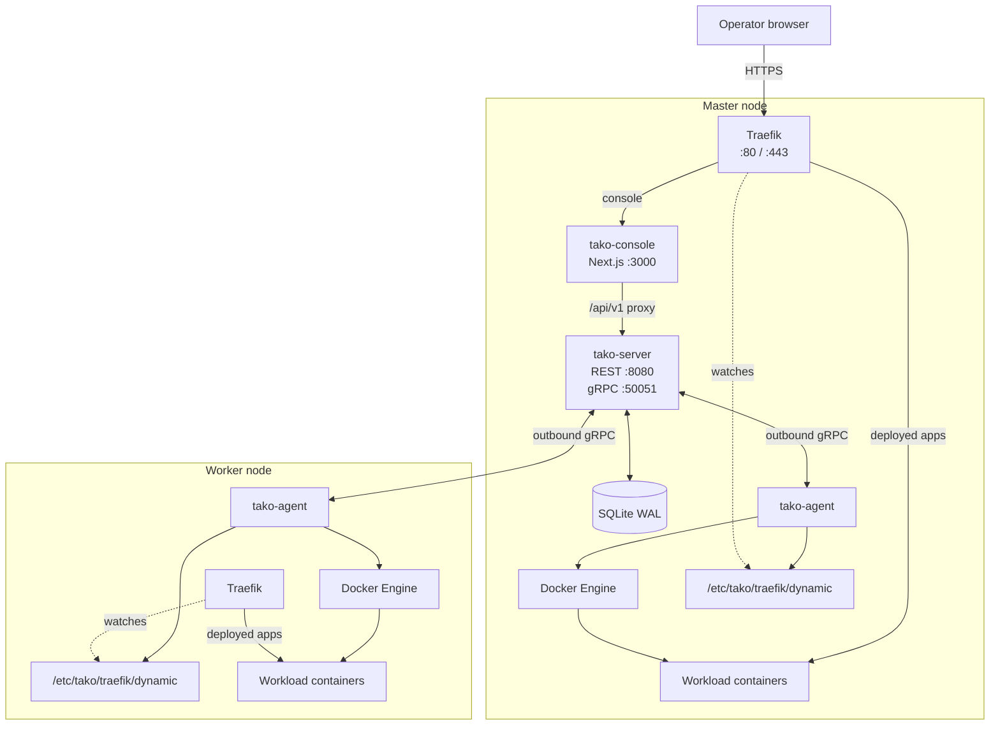
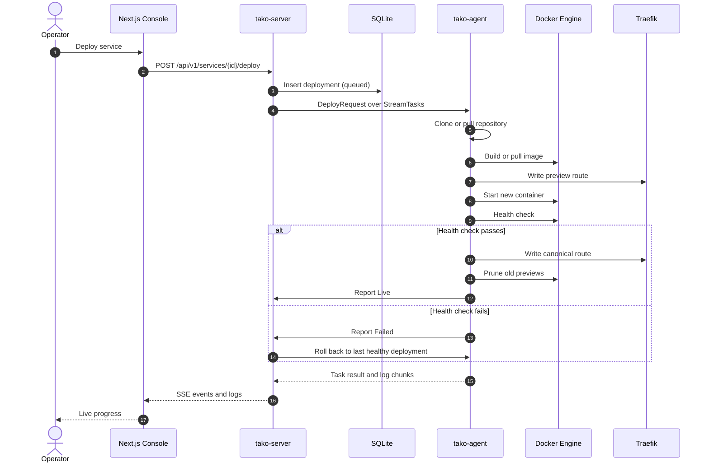

# Tako

Tako is a self-hosted deployment platform. A Go control plane schedules
containers on one or more worker nodes, a Go agent runs on each worker and
talks to the local Docker engine, and a Next.js console provides the operator
interface.

## Architecture



The master stores state in SQLite and talks to agents over gRPC. Agents never
accept inbound management connections; they dial out to the master, execute
Docker and Traefik work locally, and stream logs and task results back.

## Deployment flow



## Repository layout

```text
gettako/
├── console/      Next.js 16 operator console (App Router, React 19)
├── server/       Master control plane (Go, Chi, SQLite, gRPC)
├── agent/        Worker daemon (Go, Docker Engine SDK, outbound gRPC)
├── api/          Protobuf contracts and generated Go stubs
├── deploy/       Docker Compose stacks and Traefik configuration
├── install.sh    Master and worker installer
└── go.work       Go workspace: server, agent, and proto modules
```

## Local development

```bash
# Master server
cd server
TAKO_AGENT_SECRET=dev-token TAKO_DB_PATH=../data/tako.db go run ./cmd/server

# Worker agent
cd agent
TAKO_MASTER_URL=127.0.0.1:50051 TAKO_ENROLL_TOKEN=dev-token \
TAKO_NODE_NAME=tako-local TAKO_STATE_FILE=../data/agent.json \
go run ./cmd/agent

# Console
cd console
bun install
bun run dev
```

The console proxies `/api/v1/*` to `TAKO_SERVER_URL` (default
`http://127.0.0.1:8080`), so the browser talks to the same origin in development
and production.

## Verification

```bash
go build ./server/... ./agent/...
(cd server && go test ./...)
(cd agent && go test ./...)
(cd console && bun run lint && bun run typecheck && bun run build)
```
