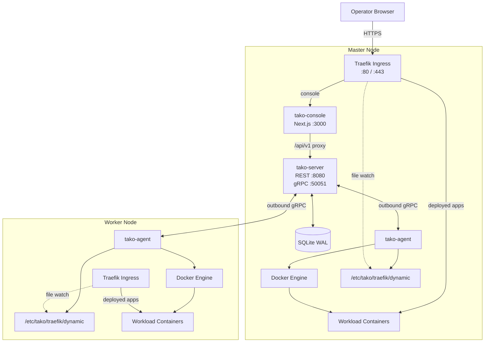
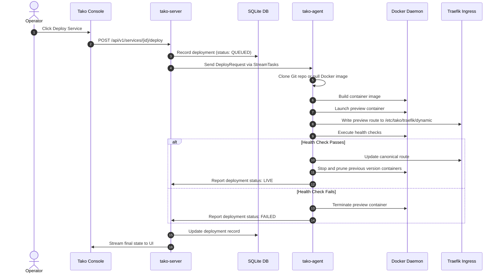

## Architectural Overview

Tako decouples system responsibilities into a centralized **Control Plane** and distributed **Edge Agents** running across nodes.

---

## Core Components

### 1. Control Plane (`tako-server`)
Written in **Go**, `tako-server` serves as the authoritative source of truth for the entire platform:
- **REST API (`:8080`)**: Provides comprehensive endpoints for the Tako Console and external CI/CD systems to manage projects, services, deployments, nodes, users, and audit logs.
- **gRPC Server (`:50051`)**: Manages persistent, bidirectional TLS streaming connections with all connected worker agents.
- **Embedded Database (SQLite WAL)**: Stores all system metadata without external database dependencies. WAL (*Write-Ahead Logging*) mode allows concurrent, non-blocking reads alongside atomic write transactions.
- **Orchestration & Scheduler**: Assigns container workloads to appropriate nodes based on resource capacity, health metrics, and node affinity labels.

### 2. Edge Agent (`tako-agent`)
A standalone, lightweight **Go** daemon deployed on every managed node:
- **Outbound-Only gRPC Connection**: The agent initiates all network connections out to the master server. This eliminates the need to expose inbound management ports on worker firewalls or manage shared SSH keys.
- **Docker Engine Manager**: Communicates directly with the local Docker daemon over the UNIX socket (`/var/run/docker.sock`) to pull images, build containers, and verify health checks.
- **Traefik Dynamic Provider**: Writes routing configurations directly to the local `/etc/tako/traefik/dynamic` directory.

### 3. Operator Console (`tako-console`)
A modern web application built with **Next.js 16**, **React 19**, **Tailwind CSS**, and **Base UI / shadcn**:
- **BFF (Backend-for-Frontend) Architecture**: Utilizes Next.js API Routes (`/api/v1/[...path]`) to securely proxy browser requests to `tako-server`.
- **Live Telemetry & Topology**: Visualizes global cluster topology, gRPC RTT latency, node resource utilization, and container states in real time.

---

## gRPC Communication Protocol

Communication between `tako-server` and `tako-agent` relies on bidirectional gRPC streams defined in `api/proto/tako/v1`:

1. **`StreamTasks`**:
   - The master dispatches deployment, restart, cancel, and rollback tasks to the agent.
   - The agent continuously streams back step-by-step build events, container logs, and execution status.
2. **`StreamTelemetry`**:
   - The agent periodically streams CPU utilization, RAM usage, disk I/O metrics, network rx/tx throughput, and active container inventories to the master.
   - The master computes round-trip latency (RTT) dynamically for telemetry analysis and dashboard display.

---

## Deployment Lifecycle

Deployments are executed with isolated preview validation to guarantee zero downtime before traffic switchover:

