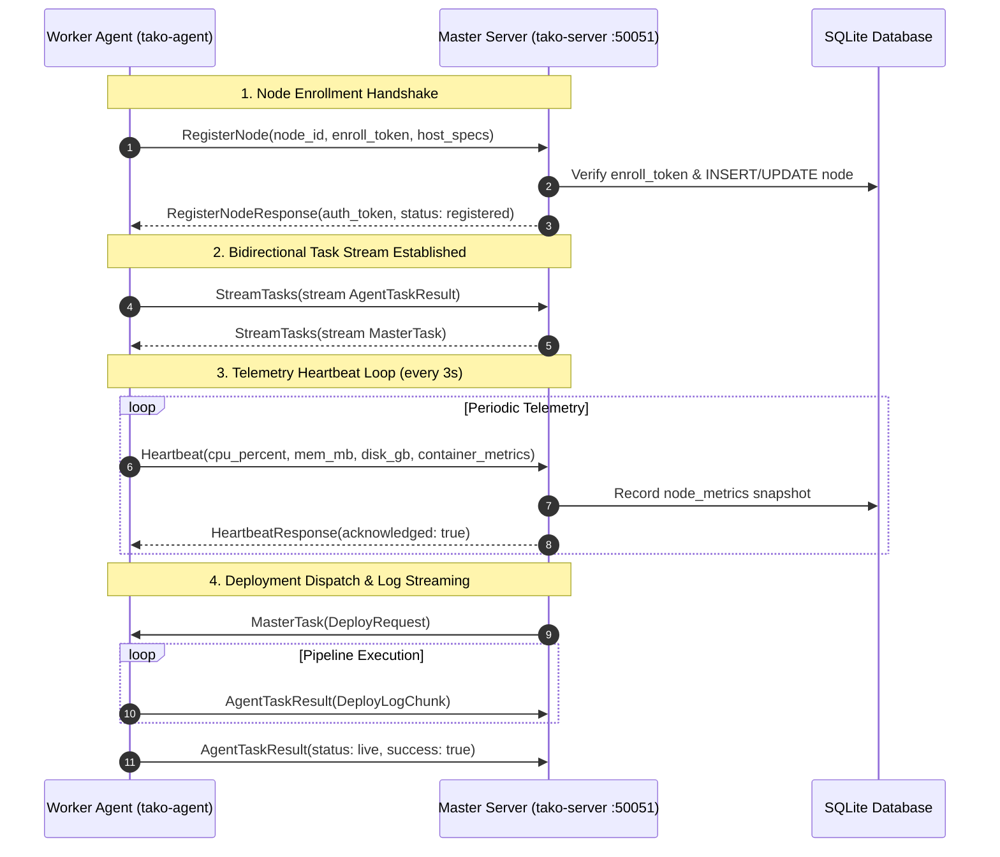

## Overview

Worker nodes in Tako communicate with the master server via an outbound gRPC stream over HTTP/2. Rather than exposing an inbound HTTP server or requiring root SSH keys on worker hosts, the `tako-agent` daemon initiates all network connections outbound to the master on port `50051`.

---

## gRPC Communication Flow



---

## Protocol Buffer Interface (`tako.v1.AgentService`)

The core communication contract is defined in `api/proto/tako/v1/agent.proto`:

```protobuf
service AgentService {
  // Registers a new node or reconnects an existing node with an enrollment token
  rpc RegisterNode (RegisterNodeRequest) returns (RegisterNodeResponse);

  // Periodic heartbeat carrying host CPU, memory, disk, network, and per-container metrics
  rpc Heartbeat (HeartbeatRequest) returns (HeartbeatResponse);

  // Bidirectional multiplexed stream for dispatching commands and streaming responses
  rpc StreamTasks (stream AgentTaskResult) returns (stream MasterTask);
}
```

---

## 1. Node Registration Handshake

When a worker node starts:

1. The agent inspects its local state file (`/data/agent.json`). If uninitialized, it generates a unique `node_id` and collects host hardware telemetry:
   - Operating system and kernel version (from `/etc/os-release` and `uname`).
   - Total physical CPU cores and memory capacity.
   - Total storage capacity on the root filesystem.
   - Installed Docker Engine daemon version.
2. The agent issues a `RegisterNode` RPC call to the master server, including the cluster enrollment token (`TAKO_AGENT_SECRET`).
3. The master validates the enrollment token against the cluster settings stored in SQLite. If valid, the node record is created or updated to `online`, and a scoped session authentication token is returned.

---

## 2. Multiplexed Bidirectional Task Stream (`StreamTasks`)

Once registered, the agent calls `StreamTasks` to open a continuous, bidirectional HTTP/2 stream:

### Master-to-Agent Dispatches (`MasterTask`)

The master server transmits structured tasks to the worker agent over the stream:

- **`DeployRequest`:** Instructs the agent to clone a repository, build a container image, configure Traefik routes, execute health checks, and manage cutover.
- **`ExecCommandRequest`:** Dispatches interactive or one-off commands into running application containers (used by the Console web terminal).
- **`ContainerLogsRequest`:** Requests real-time stdout/stderr log streams for a specific container.
- **`ContainerActionRequest`:** Dispatches lifecycle signals (`start`, `stop`, `restart`, `kill`).
- **`CancelTaskRequest`:** Aborts an in-flight deployment pipeline immediately.

### Agent-to-Master Results (`AgentTaskResult`)

The agent streams progress and command output back to the master in real time:

- **`DeployLogChunk`:** Carries step names (`Clone`, `Build`, `Deploy`, `Health check`), timestamped log messages, and error indicators. The master forwards these chunks to the internal event bus, which broadcasts them to connected browsers via Server-Sent Events (SSE).
- **`ExecCommandResponse`:** Returns terminal output bytes and command exit codes.
- **`ContainerLogsResponse`:** Returns streamed log lines from the Docker daemon.

---

## 3. Host & Container Telemetry Heartbeats (`Heartbeat`)

Every 3 seconds, the agent samples system performance counters and transmits a `HeartbeatRequest`:

- **Host Telemetry:** CPU utilization percentage, used memory in megabytes, used disk space in gigabytes, and network input/output rates (KB/s).
- **Per-Container Telemetry (`ContainerTelemetry`):** For each running container tagged with Tako labels, the agent samples container CPU percent, memory usage against configured limits, and network throughput.
- **Retention & Historical Graphs:** The master server writes these snapshots to the `node_metrics` table in SQLite, which powers the live graphs in the Tako Console.

---

## Fault Tolerance & Reconnection

If network connectivity between a worker node and the master server drops:

1. **Autonomous Operation:** Deployed containers and the local Traefik proxy continue running undisturbed on the worker node. Active user traffic is not affected by control plane disconnections.
2. **Exponential Backoff:** The agent enters a reconnection loop with exponential backoff (starting at 1 second and capping at 30 seconds).
3. **Liveness Detection:** The master server marks the node as `offline` if no heartbeat is received within 15 seconds. When the agent reconnects, the node status is automatically restored to `online`.
