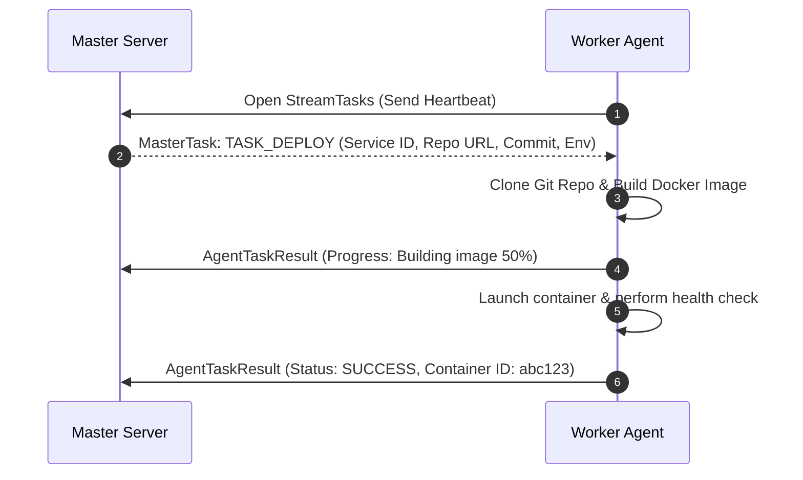

## Overview

The communication between `tako-server` and `tako-agent` is implemented using **Protocol Buffers v3** and **gRPC over HTTP/2**. 

All protocol contracts are defined in [api/proto](file:///Users/SupianIDz/Work/gettako/api/proto) and compiled into native Go stubs.

---

## gRPC Service Definition

The core agent service definition is declared in `api/proto/tako/v1/agent.proto`:

```protobuf
syntax = "proto3";

package tako.v1;

service AgentService {
  // Registers a new node or authenticates an existing node
  rpc EnrollNode (EnrollNodeRequest) returns (EnrollNodeResponse);

  // Bidirectional long-lived stream for task orchestration and logs
  rpc StreamTasks (stream AgentTaskResult) returns (stream MasterTask);

  // Unidirectional streaming telemetry metrics (CPU, RAM, Disk)
  rpc SendMetrics (stream NodeMetrics) returns (MetricsAck);

  // Container log streaming
  rpc StreamContainerLogs (ContainerLogsRequest) returns (stream ContainerLogChunk);
}
```

---

## Node Enrollment & Authentication Handshake

When a worker node starts up:

1. **Enrollment Request (`EnrollNode`):**
   - The agent sends an `EnrollNodeRequest` containing its hostname, architecture (`amd64` / `arm64`), CPU cores, memory size, public/private IP, and the enrollment token (`TAKO_ENROLL_TOKEN`).
2. **Token Verification:**
   - The master server validates the enrollment token against `TAKO_AGENT_SECRET` or active node records in SQLite.
3. **Session Token Issuance:**
   - If verified, the server issues a unique `NodeSessionToken` and assigns a canonical `node_id`.
   - The agent persists this token in its local state file (`/data/agent.json` or `/tmp/tako-agent.json`) so it can reconnect across reboots without re-entering the enrollment token.

---

## Bidirectional Task Streaming (`StreamTasks`)

Once enrolled, the agent opens a persistent bidirectional gRPC stream `StreamTasks`:



### Supported Task Types:

| Task Type | Description |
| :--- | :--- |
| `TASK_DEPLOY` | Clone or pull repository, build Docker image, launch container, configure Traefik route, check health. |
| `TASK_STOP` | Gracefully stop and remove a running service container. |
| `TASK_RESTART` | Restart container and verify health check. |
| `TASK_EXEC` | Execute an ephemeral one-off command inside the container (used by Web Terminal and Cron jobs). |
| `TASK_PRUNE` | Clean up dangling Docker images and old stopped preview containers. |

---

## Real-Time Metrics Streaming (`SendMetrics`)

Every 3 seconds (configurable via `TAKO_METRICS_INTERVAL`), the agent collects host and container metrics using `gopsutil` and Docker Engine SDK:

- **CPU Utilization:** Total CPU percent and per-core breakdown.
- **Memory:** Total RAM, used RAM, available RAM, and percent.
- **Disk:** Total disk space, free space, and usage percent for `/`.
- **Containers:** Number of running, stopped, and unhealthy containers.
- **Latency:** gRPC round-trip ping time in milliseconds.

These metrics are streamed to the master server and saved to SQLite with automated 7-day retention cleanup.
