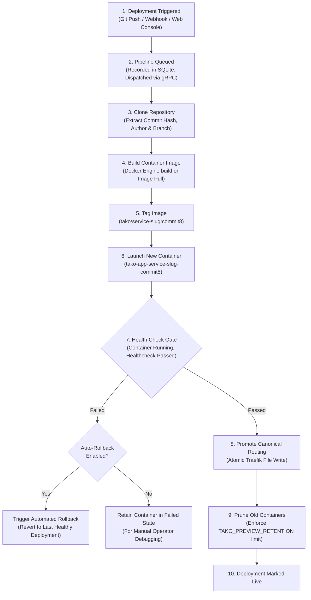
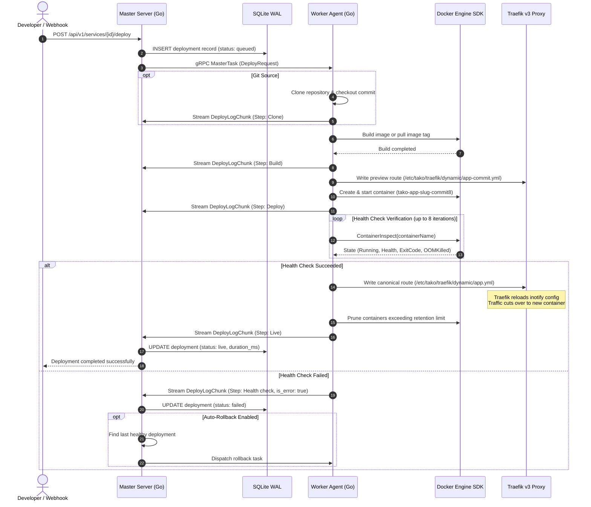

## Overview

Deployments in Tako are executed as a structured pipeline. Rather than stopping an existing container and starting a replacement, Tako runs the incoming container alongside the active version under an isolated preview configuration. Public traffic is switched to the new container only after health checks succeed.

---

## High-Level Deployment Pipeline

---

## Sequence Diagram: Component Interactions

---

## Detailed Pipeline Stages

### 1. Trigger & Scheduling
A deployment begins when a developer clicks **Deploy** in the console, calls the REST API, or pushes a commit to a configured GitHub branch. The master server creates a deployment record in SQLite with status `queued` and assigns a unique ID (such as `dep-9b7e3f`).

### 2. gRPC Task Dispatch
The master server locates the active `AgentSession` corresponding to the service's assigned `node_id`. The deployment parameters (repository URL, branch, commit, Dockerfile path, environment variables, ports, and resource limits) are packed into a protobuf `DeployRequest` and sent across the persistent gRPC task channel.

### 3. Clone & Metadata Extraction
If the service is configured with a Git repository, the agent performs a local clone into an ephemeral workspace. It extracts the HEAD commit hash, author name, and commit message, streaming these details back to the master to update the deployment card in the console.

### 4. Build or Image Pull
- **Git Source:** The agent invokes the Docker daemon to build a container image using the specified `Dockerfile` and build arguments.
- **Pre-built Image:** If an image repository is specified, the agent pulls the image directly using the Docker Engine SDK.
- The image is tagged locally as `tako/<service-slug>:<commit8>`.

### 5. Preview Routing & Container Creation
To prevent port collisions and ensure traffic isolation:
- The container name is prefixed with the short commit hash: `tako-app-<service-slug>-<commit8>`.
- The agent writes a commit-specific preview routing configuration to `/etc/tako/traefik/dynamic/<service-slug>-<commit8>.yml`.
- The container is connected to the bridge network `tako-network` with memory and CPU limits applied.

### 6. Health Check Verification Gate
Before routing public traffic to the new container, the agent verifies container stability:
- It checks `inspect.State.Running`, ensuring the process has not terminated unexpectedly.
- If a `HEALTHCHECK` instruction is present in the Dockerfile, it inspects `inspect.State.Health.Status` until the container reports `healthy`.
- It verifies that the container has not encountered an Out-Of-Memory (OOM) termination (`inspect.State.OOMKilled == false`).

### 7. Zero-Downtime Canonical Cutover
Once health checks pass:
- The agent updates the canonical Traefik configuration file at `/etc/tako/traefik/dynamic/<service-slug>.yml`.
- Traefik detects the file modification via filesystem events (`inotify`) and seamlessly cuts over incoming requests to the new container.
- Live traffic never encounters dropped connections or incomplete startup screens.

### 8. Preview Retention & Container Pruning
After traffic promotion, the agent checks the number of running historical containers for that service. Old containers exceeding the retention threshold (`TAKO_PREVIEW_RETENTION`, default: 2) are gracefully stopped and removed.

---

## Automated Rollback Mechanism

If a new container fails its health checks (for example, due to a fatal boot crash, missing runtime environment variable, or database connection timeout):

1. The agent marks the health check step as `failed` and cleans up the preview configuration file.
2. The master server inspects the service setting `auto_rollback_enabled`.
3. If auto-rollback is enabled, the master queries SQLite for the most recent deployment that finished in `live` or `healthy` status.
4. It immediately triggers an automated rollback to that stable release, keeping production traffic uninterrupted.
5. If auto-rollback is disabled in service settings, the container is preserved in its failed state so operators can inspect stdout/stderr logs directly.
