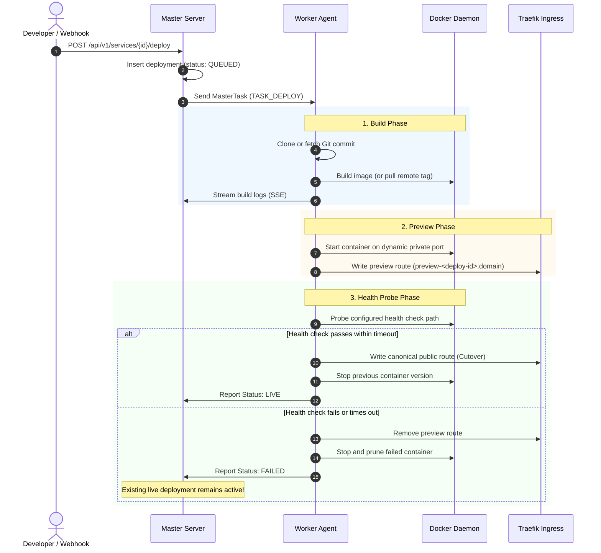

## Overview

Tako ensures that no bad build or crashing container ever drops live user traffic. Every deployment follows a strict five-stage lifecycle: **Build → Preview → Probe → Promote → Prune**.

---

## Detailed Deployment Lifecycle

---

## The 5 Lifecycle Phases

### 1. Build Phase
- If the service is Git-based, the agent clones the repository (or fetches the specific branch/commit).
- Submodules are populated if configured.
- The Docker Engine builds the image using standard `Dockerfile` or `docker-compose.yml`.
- Build logs are tagged with timestamps and streamed live over gRPC to the master server, which relays them to the Web Console via Server-Sent Events (SSE).

### 2. Preview Phase
- A new container is launched with all decrypted environment variables and port mappings.
- The agent assigns a temporary preview router in Traefik (e.g. `preview-<deploy_id>.<cluster_domain>`).
- The existing container running the previous version continues serving 100% of public traffic.

### 3. Health Probe Phase
- If a health check path is configured (e.g. `/health`), the agent probes the new container at defined intervals (e.g. every 2 seconds, up to 15 attempts).
- Both HTTP status codes `200-299` and container runtime health statuses are verified.

### 4. Promotion (Zero-Downtime Cutover)
- Once health checks succeed, the agent updates the canonical Traefik dynamic configuration file `/etc/tako/traefik/dynamic/<service_id>.yml`.
- Traefik hot-reloads the route in memory. New HTTP requests are immediately routed to the new container. Active in-flight requests on the old container finish without interruption.

### 5. Pruning & Retention
- After a configurable grace period (default: 15 seconds), the agent stops the retired container.
- Image retention policies ensure the previous 3-5 images are kept locally for instant rollback, while dangling and older layers are automatically pruned.

---

## Instant Rollback Mechanism

If an unexpected runtime bug is discovered in production:

1. Open the service in the Tako Console and select the **Deployments** tab.
2. Locate any previously successful deployment in the deployment history.
3. Click **Rollback**.
4. Because the Docker image is already cached locally on the worker node, the agent immediately starts the previous container, passes the health check, and switches the Traefik router in under 2 seconds.
