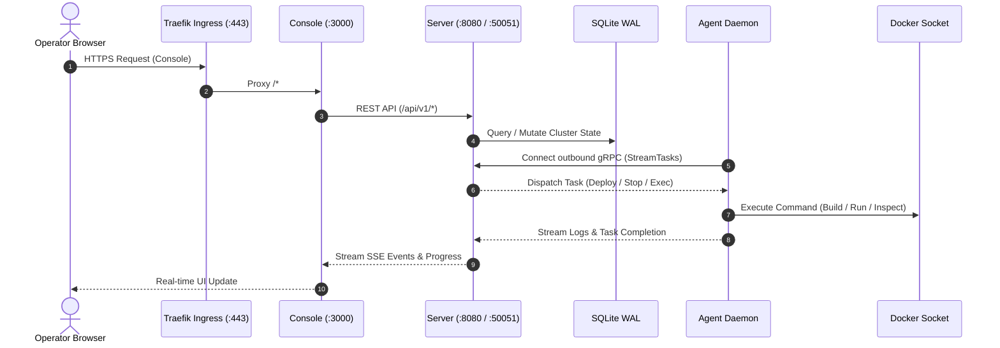

## System Components

Tako is designed with a strict separation of concerns into four core components:

```text
gettako/
├── console/          # Operator Web Interface (Next.js 16, React 19, Tailwind CSS)
├── server/           # Master Control Plane (Go REST API, SQLite WAL, gRPC server)
├── agent/            # Worker Daemon (Go daemon, Docker Engine SDK, outbound gRPC)
└── api/proto/        # Protobuf contracts (AgentTask, Metrics, ContainerLogs)
```

---

## 1. Master Control Plane (`tako-server`)

The master server acts as the central brain of the cluster. It runs as a native Go binary and performs:
- **REST & SSE API:** Serves the public HTTP API on port `8080` (used by the web console and CLI).
- **gRPC Server:** Listens on port `50051` for inbound worker agent connections.
- **Embedded Database:** Stores all cluster metadata in an embedded SQLite database using Write-Ahead Logging (WAL) for high concurrency and zero memory overhead.
- **Authentication & RBAC:** Enforces role-based permissions (Admin vs Operator), session cookies, and WebAuthn/Passkey authentication.
- **Task Orchestration:** Queues deployment tasks, dispatches commands to target nodes, and aggregates real-time cluster metrics.

---

## 2. Worker Daemon (`tako-agent`)

The agent is a compiled Go binary that runs on every node (including the master node for local container workloads).

### Key Characteristics:
- **Outbound gRPC Client:** The agent dials out to the master server at `<master-ip>:50051`. It never listens on inbound management ports.
- **Docker Engine Integration:** Communicates with the local Docker daemon directly through `/var/run/docker.sock`.
- **Task Execution Engine:** Handles Git clone, Docker builds, container provisioning, health checks, and log streaming.
- **Metrics Reporter:** Gathers CPU, memory, disk, and network stats via `gopsutil` every 3 seconds and streams them back to the master.
- **Traefik Dynamic Manager:** Atomically writes routing configuration files to `/etc/tako/traefik/dynamic`.

---

## 3. Web Console (`tako-console`)

The console is a Next.js 16 (App Router) web application designed for fast, responsive operations:
- **Single-Origin BFF Proxy:** Routes all `/api/v1/*` requests directly to `tako-server:8080`, preserving CORS security and session cookies.
- **Global Command Palette (`Cmd+K`):** Instantly search and jump to any node, service, deployment, or setting.
- **Real-Time Dashboards:** Displays live cluster metrics with adaptive chart scaling and node geolocation map.
- **In-Browser Terminal:** Interactive shell connection into running containers powered by xterm.js and virtual filesystem navigation.

---

## 4. Edge Reverse Proxy (Traefik v3)

Every node in a Tako cluster runs a local Traefik v3 instance listening on ports `80` and `443`:
- **Docker Provider:** Automatically detects containers connected to the `tako-network` bridge.
- **File Provider:** Continuously watches `/etc/tako/traefik/dynamic/*.yml` for atomic configuration reloads.
- **Automated TLS (Let's Encrypt):** Manages SSL/TLS certificate issuing, renewal, and HTTPS redirection via ACME HTTP-01 challenges.

---

## Network Communication Flow


