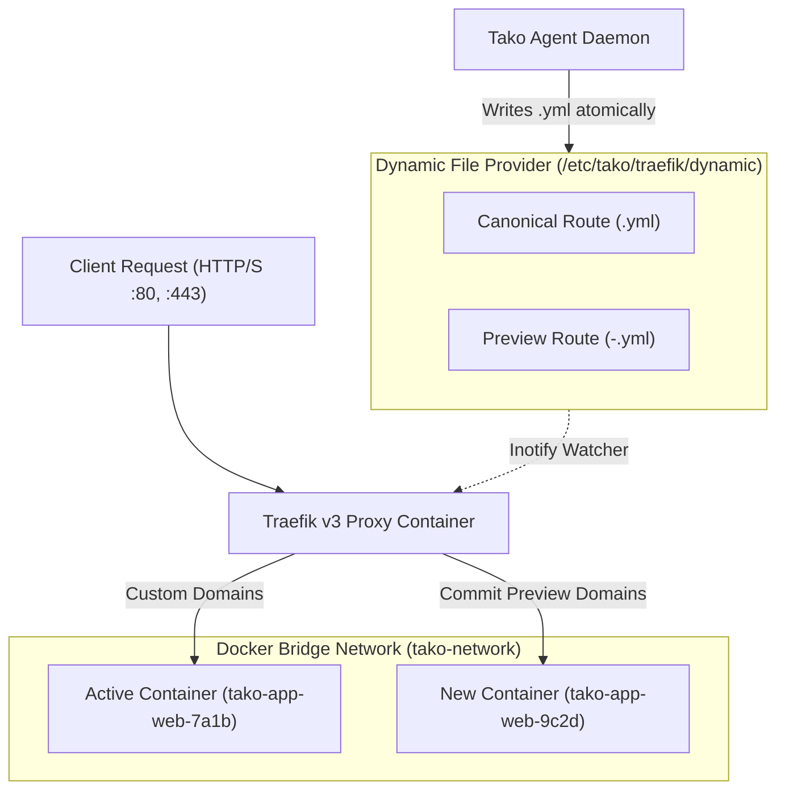
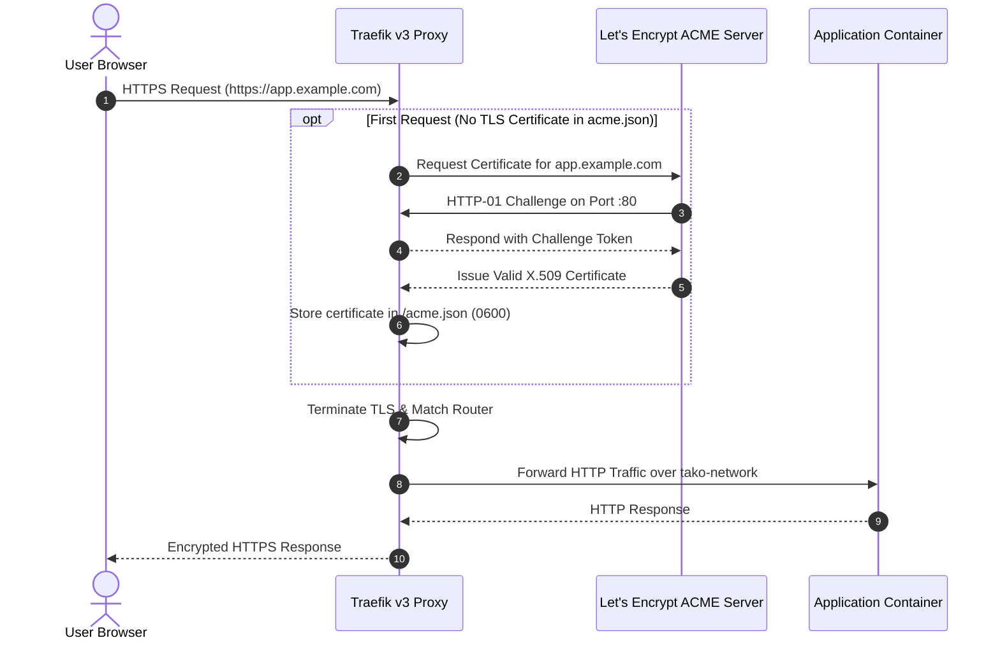

## Overview

Tako embeds **Traefik v3** as its default edge proxy. Every server node that runs web workloads runs a local Traefik container. Rather than configuring complex API hooks or restarting proxy processes, Tako utilizes Traefik's **Dynamic File Provider** with atomic file operations to manage routing rules with zero downtime.

---

## Routing & Proxy Architecture



---

## Dynamic File Provider Mechanism

Traefik monitors `/etc/tako/traefik/dynamic` using Linux inotify filesystem events. Whenever a file is added, modified, or deleted in this directory, Traefik updates its internal routing table in memory without dropping active HTTP connections or restarting worker threads.

### Configuration Hierarchy

Each service in Tako generates two distinct configuration files:

#### 1. Preview Configuration (`<service-slug>-<commit8>.yml`)
Written immediately when a new deployment container starts. It binds the incoming container to commit-specific preview domains (such as `commit8-web-app.sslip.io`). This allows internal health checks and preview testing before promoting the build to production.

```yaml
# Example: /etc/tako/traefik/dynamic/web-frontend-9c2d4e8a.yml
http:
  routers:
    web-frontend-9c2d4e8a:
      rule: "Host(`9c2d4e8a-web-frontend.198-51-100-24.sslip.io`)"
      entryPoints:
        - web
      service: web-frontend-9c2d4e8a

  services:
    web-frontend-9c2d4e8a:
      loadBalancer:
        servers:
          - url: "http://tako-app-web-frontend-9c2d4e8a:3000"
```

#### 2. Canonical Configuration (`<service-slug>.yml`)
Written only after container health checks succeed. It points production custom domains (such as `app.example.com`) to the newly verified container.

```yaml
# Example: /etc/tako/traefik/dynamic/web-frontend.yml
http:
  routers:
    web-frontend-secure:
      rule: "Host(`app.example.com`)"
      entryPoints:
        - websecure
      tls:
        certResolver: letsencrypt
      service: web-frontend

    web-frontend-http:
      rule: "Host(`app.example.com`)"
      entryPoints:
        - web
      middlewares:
        - redirect-to-https
      service: web-frontend

  services:
    web-frontend:
      loadBalancer:
        servers:
          - url: "http://tako-app-web-frontend-9c2d4e8a:3000"
```

---

## Automated TLS with Let's Encrypt



### Key TLS Characteristics:
- **HTTP-01 ACME Challenge:** Traefik intercepts incoming HTTP requests matching `/.well-known/acme-challenge/*` on port 80 to satisfy Let's Encrypt validation.
- **Certificate Storage:** Certificates are saved in `/etc/tako/traefik/acme.json` with strict `0600` permissions.
- **Automatic Renewal:** Traefik checks certificate expiration daily and triggers background renewal 30 days before expiration.

---

## Wildcard Preview Domains via sslip.io

To provide instant domain access without requiring manual DNS configuration, Tako generates canonical preview domains using `sslip.io`:

- If a worker node's IP address is `198.51.100.24`, dashes replace periods to form `198-51-100-24`.
- A service named `api-server` automatically receives:
  ```text
  http://api-server-198-51-100-24.sslip.io
  ```
- Public DNS queries for any `*.sslip.io` hostname resolve directly to the embedded IP address, allowing immediate browser testing.
