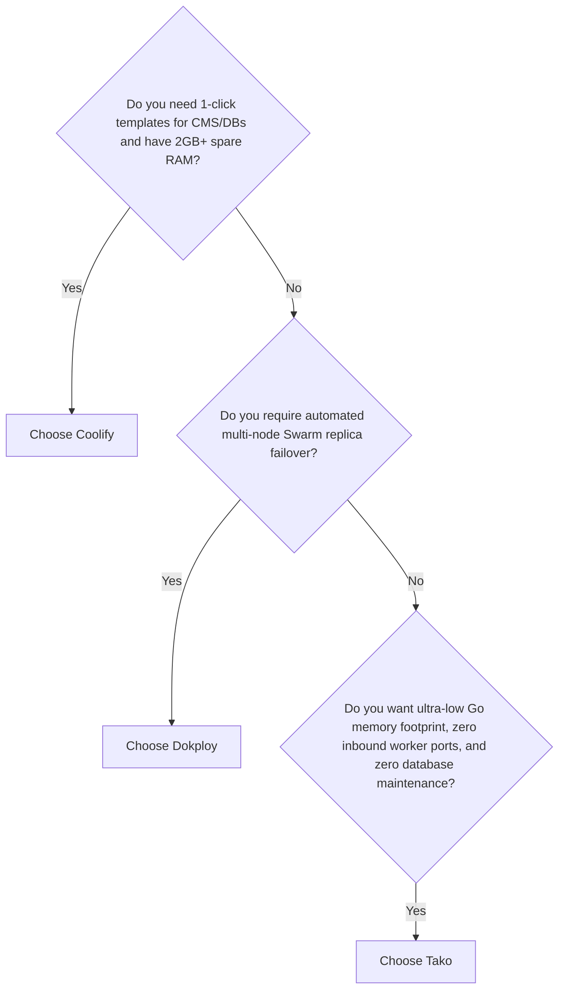

## Why Compare?

In the self-hosted Platform-as-a-Service (PaaS) ecosystem, **Coolify** and **Dokploy** are two of the most popular open-source solutions serving as self-hosted alternatives to Heroku, Render, and Vercel.

Each platform was architected with fundamentally different engineering philosophies and technology stacks. This page provides an objective, factual technical comparison based on the official documentation and source code architecture of each platform to help you evaluate which solution best fits your infrastructure.

---

## Architectural & Feature Comparison

| Architectural Aspect | Coolify (v4) | Dokploy | Tako |
| :--- | :--- | :--- | :--- |
| **Control Plane Language & Framework** | PHP 8.3+ / Laravel 11 (Blade + Livewire + Alpine.js) | TypeScript / Next.js (React Server Components + API Routes) | **Go** (`tako-server`) + **Next.js 16** (`tako-console`) |
| **Worker Node Daemon** | No dedicated daemon (executes remote Docker commands via SSH) | Native Docker Swarm Worker daemon | **Standalone Go Agent** (`tako-agent`) |
| **Metadata Database** | PostgreSQL 15 | PostgreSQL | **Embedded SQLite WAL** (Zero external DB ops) |
| **Cache & Queue Broker** | Redis 7 | Internal Node.js runtime / PostgreSQL | **Internal Go Channels & Goroutines** |
| **Real-time Protocol & Telemetry** | WebSockets (Laravel Reverb / Soketi) | Next.js Server-Sent Events / WebSockets | **gRPC Bidirectional Streaming** (`StreamTasks`, `StreamTelemetry`) |
| **Multi-Server Communication Model** | **SSH Push Model**: Master initiates SSH into port 22 on target servers | **Docker Swarm Overlay**: Nodes join a Docker Swarm cluster | **Outbound-Only gRPC**: Agent dials out to Master; **0 inbound ports** on workers |
| **Worker Node Firewall Security** | Requires inbound SSH port (22) open to public / master | Requires Swarm ports (`2377`, `7946`, `4789`) open | **Worker nodes completely isolated behind NAT / Firewall** |
| **Control Plane Idle RAM Footprint** | ~1.0 GB – 2.0 GB+ RAM (Laravel + Postgres + Redis + Reverb) | ~500 MB – 1.0 GB RAM (Next.js + Postgres) | **~50 MB – 120 MB RAM** (`tako-server` + `tako-console`) |
| **Worker Node Idle RAM Footprint** | 0 MB (no daemon, intermittent SSH CPU spikes) | ~80 MB – 150 MB RAM (Swarm daemon overhead) | **~15 MB – 25 MB RAM** (`tako-agent`) |
| **Reverse Proxy & Ingress** | Traefik (HTTP & TCP routing via Docker labels) | Traefik (Docker Swarm provider) | Traefik (Local dynamic file provider via `/etc/tako/traefik/dynamic`) |
| **Build Engines Supported** | Nixpacks, Dockerfile, Heroku Buildpacks, Compose | Nixpacks, Dockerfile, Heroku Buildpacks, Compose | Native Dockerfile, Git Repositories, Pre-built Registry Images |

---

## In-Depth Analysis: Three Distinct Philosophies

### 1. Coolify: Monolithic Laravel & SSH Push Architecture
* **How It Works**: Coolify centralizes application logic within a Laravel monolith. When adding remote servers, Coolify asks for SSH credentials (username, IP, private SSH key). All deployments are executed by opening an SSH connection from the master to the worker and invoking Docker CLI commands remotely.
* **Strengths**:
  - Extensive "one-click" open-source template library (WordPress, Ghost, databases, message queues).
  - No need to install third-party daemon binaries on target servers beyond standard Docker and SSH.
* **Trade-offs**:
  - **High Resource Overhead**: Running PHP-FPM, PostgreSQL, Redis, and a WebSocket daemon simultaneously consumes 1.5 GB+ RAM on the master server before running any user applications.
  - **SSH Security Surface**: The master server must securely store root SSH private keys for every worker. If the master server is compromised, all connected worker machines are exposed.
  - **Isolated Multi-Server Traffic**: Adding servers does not configure automatic load balancing; each server operates independently and requires an external load balancer (such as Cloudflare).

---

### 2. Dokploy: Modern Full-Stack JavaScript & Docker Swarm Clustering
* **How It Works**: Dokploy adopts a modern TypeScript and Next.js stack, tightly coupled with **Docker Swarm**. The primary server acts as the Swarm Manager, while additional nodes join as Swarm Workers over an encrypted overlay network.
* **Strengths**:
  - **Native Swarm Clustering**: Supports container replica scaling across nodes out of the box.
  - **Automated Container Failover**: If a worker node crashes, Docker Swarm automatically reschedules containers to healthy surviving nodes.
  - Modern, responsive React / Next.js interface.
* **Trade-offs**:
  - **Swarm Overlay Network Complexity**: Docker Swarm requires opening specific TCP/UDP ports (`2377`, `7946`, `4789`) and managing IPSec VXLAN overlays, which can introduce instability on certain cloud providers or heavily NAT-ed networks.
  - **External Database Dependency**: Requires a dedicated PostgreSQL container running continuously to manage state.

---

### 3. Tako: Native Go, Outbound gRPC Streaming, & Embedded SQLite
* **How It Works**: Tako was engineered specifically for execution speed, network security, and zero operational bloat. It eliminates SSH intermediaries and avoids Swarm/Kubernetes overlay complexity:
  1. **Outbound-Only Agent**: Worker nodes run a single compiled Go binary (`tako-agent`, < 25 MB RAM). The agent dials out to the master server over TLS gRPC. Port 22 can be completely closed, and worker machines can safely sit behind home/office NAT without public static IPs.
  2. **Zero-Dependency Database**: No PostgreSQL or Redis containers. All state is maintained in an embedded SQLite database using WAL mode, delivering sub-microsecond in-memory reads and atomic file snapshots.
  3. **Atomic File-Based Traefik Sync**: The local agent writes Traefik configuration atomically to `/etc/tako/traefik/dynamic`. This allows preview environments and canonical routes to update instantly without cross-node network dependencies.

---

## When to Choose Each Platform

- **Choose Coolify if**: You want an extensive library of pre-packaged application templates (WordPress, Strapi, MinIO), have VPS instances with at least 2 GB+ RAM, and are comfortable managing SSH key access across servers.
- **Choose Dokploy if**: You want native Docker Swarm replica distribution across multiple servers and prefer a full-stack TypeScript ecosystem.
- **Choose Tako if**:
  - You want maximum server efficiency on cost-effective or resource-constrained VPS instances (512 MB – 1 GB RAM).
  - Network security is paramount: worker nodes must not open any inbound ports and no SSH private keys may reside on the master server.
  - You need deterministic deployments, instant rollback verification, and real-time telemetry streaming via low-latency gRPC.
  - You refuse to operate external database servers (PostgreSQL / Redis) simply to power an infrastructure control plane.
