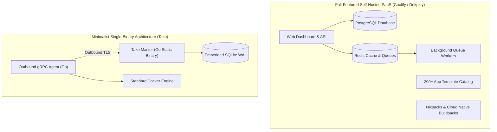
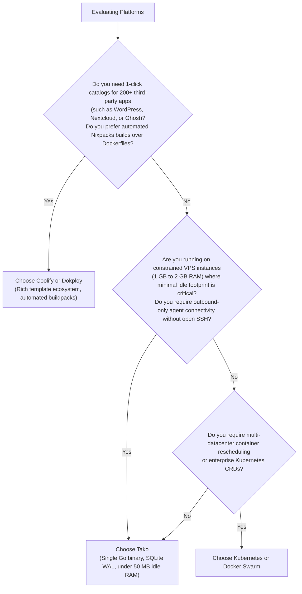

## Overview

The open-source self-hosting ecosystem has produced several capable platforms for running applications on virtual private servers. **Coolify** and **Dokploy** are two mature, widely adopted solutions that have made self-hosting practical and accessible for thousands of developers. Both projects offer vibrant communities, rich feature sets, and broad application catalogs.

Tako was built to occupy a distinct architectural niche: **single-binary minimalism with an outbound-only agent network model**.

Rather than declaring one approach better than another, this document evaluates the technical trade-offs between these platforms to help you select the right tool for your specific operational requirements.

---

## Technical Architecture Overview

---

## Architectural Comparison Matrix

| Operational Criterion | Coolify / Dokploy | Tako |
| :--- | :--- | :--- |
| **Control Plane Runtime** | Multi-container stack (Web app, PostgreSQL, Redis, worker queues) | Single static Go binary + embedded SQLite database |
| **Idle Memory Consumption** | ~500 MB to 1.5 GB RAM baseline | Under 50 MB RAM baseline |
| **Node Orchestration Network** | Inbound SSH (port 22) or Docker socket | Outbound-only gRPC over TLS (port 50051) |
| **Worker Ports Required** | Port 22 (SSH) + Ports 80 & 443 | Ports 80 & 443 only (no inbound SSH or management ports) |
| **Application Marketplace** | 200+ one-click community templates (WordPress, Ghost, Nextcloud, etc.) | Core database templates only (PostgreSQL, MySQL, Redis, MongoDB) |
| **Build System** | Nixpacks, Cloud Native Buildpacks, Dockerfiles | Standard `Dockerfile` or `docker-compose.yml` only |
| **Multi-Tenancy** | Multi-organization support, team workspaces | Single flat workspace (Admin and Member roles) |
| **State Storage & Backups** | External PostgreSQL database dump + filesystem configs | Single SQLite file (`tako.db`) online snapshot |
| **Primary Target Environment** | Homelabs, community app catalogs, multi-tenant setups | Custom microservices, constrained VPS nodes, private subnets |

---

## Detailed Trade-off Analysis

### 1. Resource Overhead vs Feature Surface Area

#### Coolify & Dokploy
- **Strengths:** Providing a comprehensive experience requires multiple backing services. Having PostgreSQL, Redis, and worker queues allows these platforms to run complex asynchronous workflows, queue retries, and manage extensive application marketplace catalogs.
- **Trade-off:** The baseline memory footprint is higher. On small VPS instances (such as 1 GB or 2 GB RAM servers), running the platform itself consumes a noticeable portion of total available RAM, leaving less headroom for user workloads.

#### Tako
- **Strengths:** By implementing the control plane in Go with an embedded SQLite database, Tako eliminates background database daemons entirely. The master server idles at under 50 MB of RAM, leaving maximum system memory for user applications.
- **Trade-off:** Tako intentionally limits its operational scope. It does not provide an extensive catalog of 200+ third-party community applications or multi-tenant organizational hierarchies.

---

### 2. Node Connectivity: Inbound SSH vs Outbound gRPC

#### Coolify & Dokploy
- **Mechanism:** The control plane initiates SSH connections (port 22) into managed worker servers.
- **Trade-off:** Worker servers must keep port 22 reachable by the master, requiring public IP addresses, root SSH keys stored on the master, or internal VPN tunnels.

#### Tako
- **Mechanism:** Remote worker nodes run a lightweight Go agent that initiates an outbound gRPC stream to the master server over TLS.
- **Trade-off:** Remote worker nodes require zero open management ports and no inbound SSH access. Nodes can reside behind firewalls, private cloud VPCs, or dynamic IPs without port forwarding.

---

### 3. Build Philosophy: Automated Buildpacks vs Explicit Dockerfiles

#### Coolify & Dokploy
- **Mechanism:** Integrates Nixpacks and Cloud Native Buildpacks, which inspect source code to detect runtimes and build containers automatically.
- **Trade-off:** Very convenient for developers who do not want to write Dockerfiles. However, buildpack engines add disk overhead and can introduce obscure build failures when automatic dependency detection misidentifies framework versions.

#### Tako
- **Mechanism:** Requires explicit `Dockerfile` or `docker-compose.yml` configurations for custom code.
- **Trade-off:** Eliminates guessing and hidden build logic. Builds behave identically on a local developer workstation and on a production server. Operators who prefer not writing Dockerfiles will find buildpack-oriented platforms more convenient.

---

## Decision Matrix: When to Use What

### When Coolify or Dokploy is the Better Fit
- You want an extensive catalog of pre-packaged third-party open-source applications ready to deploy in a single click.
- You prefer deploying source code repositories without writing a `Dockerfile`.
- You need multi-tenant organization workspaces to manage different client teams from a single dashboard.

### When Tako is the Better Fit
- You are running on budget virtual private servers where minimizing platform resource overhead is paramount.
- You prefer writing explicit Dockerfiles for full reproducibility and transparency.
- You want remote nodes to connect securely without opening SSH port 22 or storing root keys in the panel.
- You prefer simple disaster recovery involving a single SQLite database file.
