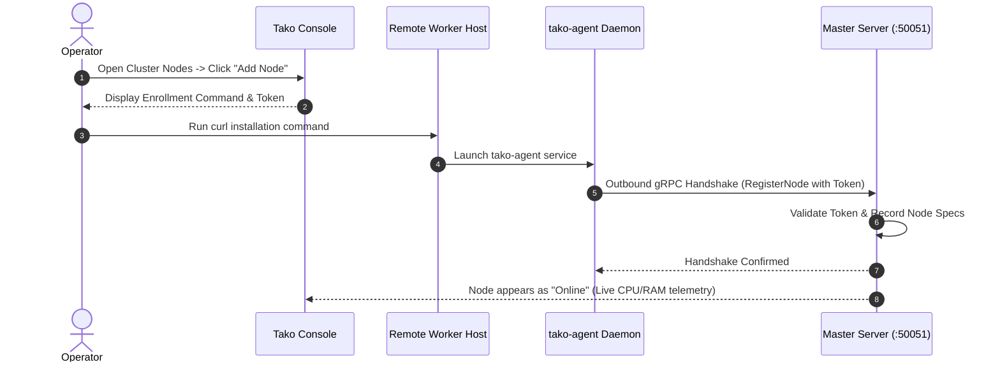

## Overview

Tako allows you to scale beyond a single master server by enrolling external Linux nodes into your cluster. Worker nodes run container workloads while maintaining a continuous outbound gRPC stream to the master server.

Because worker nodes connect outbound over TLS, they can be located in any cloud provider (Hetzner, DigitalOcean, AWS, OVH) or on-premises environment without requiring direct network peering or open inbound SSH access.

---

## Node Enrollment Architecture



---

## Step 1: Retrieve the Enrollment Token

1. Log into the Tako Console.
2. In the sidebar, navigate to **Nodes**.
3. Click **Add Node** in the top right corner.
4. Copy the pre-populated installation command, which includes your cluster's enrollment token.

Alternatively, you can retrieve the cluster token directly from the master server terminal:

```bash
grep TAKO_AGENT_SECRET /opt/tako/.env
```

---

## Step 2: Run the Agent Installer on the Worker Node

Log into your remote worker server via SSH and execute the installer:

```bash
curl -fsSL https://gettako.dev/install.sh | bash -s -- \
  --agent \
  --token "<YOUR_ENROLLMENT_TOKEN>" \
  --master "<MASTER_PUBLIC_IP>:50051"
```

### Installation Parameters

- `--agent`: Tells `install.sh` to configure the system as a worker daemon rather than a master server.
- `--token`: The cluster enrollment secret.
- `--master`: The public IP or domain name and port (default: `50051`) of your master server.
- `--dir` (optional): Installation directory on the worker node (default: `/opt/tako`).

During installation, the script:
1. Installs Docker Engine and Docker Compose if not already present.
2. Creates the `/etc/tako/traefik/dynamic` dynamic directory.
3. Launches the local Traefik edge proxy on ports 80 and 443.
4. Starts the `tako-agent` daemon, which initiates the outbound gRPC connection to the master.

---

## Step 3: Verify Node Health & Metrics

Once installed, return to the Tako Console:

1. Open **Nodes** in the sidebar.
2. Your new server will appear with an **Online** status badge.
3. The node details page displays real-time telemetry:
   - Operating system and Linux kernel release.
   - Total physical CPU cores and live CPU utilization percentage.
   - Total memory and real-time memory usage (MB).
   - Root filesystem storage capacity and disk usage (GB).
   - Network receive and transmit throughput (KB/s).

---

## Liveness Monitoring & Failure Recovery

The master server runs a continuous background liveness watcher:

- **Heartbeat Frequency:** The agent transmits host metrics every 3 seconds.
- **Heartbeat Timeout:** If the master fails to receive a heartbeat for 15 seconds, the node status transitions to `offline`.
- **Automatic Recovery:** If the node reboots or connectivity recovers, the agent automatically reconnects and returns to `online` status without manual operator intervention.

---

## Removing a Server Node

To decommission a worker node:

1. In the Tako Console, ensure no active services are currently assigned to the target node. Reassign any active workloads to another node first.
2. Open **Nodes** and select the node.
3. Click **Delete Node** in the node settings menu.
4. On the worker server, stop and remove the agent stack:
   ```bash
   cd /opt/tako && docker compose down -v
   ```
