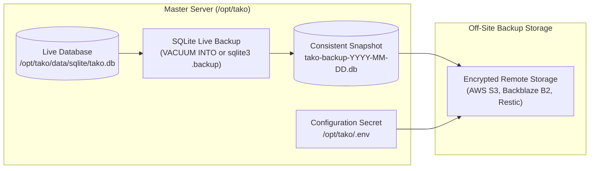

## Overview

Because the Tako master server relies on embedded SQLite rather than an external database cluster, the entire platform state (users, project configurations, encrypted environment variables, node registrations, domains, and deployment history) resides in a single database file.

---

## Backup Architecture



---

## What is Included in the Database Backup

The SQLite database (`tako.db`) contains:
- User accounts, hashed passwords, and session records.
- Projects, environments, and services configuration.
- Service domain routing and SSL metadata.
- AES-256-GCM encrypted service environment variables and secrets.
- Enrolled worker node records and enrollment tokens.
- Deployment history, execution steps, and build logs.
- Full system audit log history.

<Important>
The SQLite database backup contains cluster configuration, but **does not** contain application data stored inside Docker named volumes (such as PostgreSQL database directories or media files). Application volumes should be backed up using volume dump tools or database native commands.
</Important>

---

## Automated Backups to S3 / Cloudflare R2 (Recommended)

Tako includes native integration with S3-compatible object storage providers (AWS S3, Cloudflare R2, MinIO, Backblaze B2, DigitalOcean Spaces) directly within the web console:

### 1. Configure Storage in Settings
1. Open the Tako Console, go to **Settings**, and select the **Backups & S3** tab.
2. Fill in your bucket credentials:
   - **S3 Endpoint:** e.g. `https://<account-id>.r2.cloudflarestorage.com` (or standard AWS S3 endpoint).
   - **Region:** e.g. `auto` or `us-east-1`.
   - **Bucket Name:** e.g. `tako-cluster-backups`.
   - **Access Key ID & Secret Access Key:** Your IAM or API credentials.
3. Click **Test S3 Connection** to verify permissions.
4. Click **Save Settings**.

### 2. Manual & Scheduled Snapshots
- **Create Immediate Snapshot:** In **Settings -> Backups**, click **Create Snapshot Now**. Tako executes an atomic SQLite checkpoint, compresses the database, and streams it to your bucket with SHA-256 integrity verification.
- **Automated Daily Schedule:** Enable **Daily Automated Backup** to configure an automatic snapshot trigger every midnight UTC with configurable retention windows.

### 3. One-Click Snapshot Restore
To restore your cluster from a previous snapshot:
1. Open **Settings -> Backups** and view the list of available snapshots stored in your S3 bucket.
2. Select the desired snapshot and click **Restore**.
3. Confirm the prompt. The control plane safely hot-replaces the SQLite database and restarts services seamlessly.

---

## Manual CLI Database Snapshots

If you prefer operating directly through host terminal access:

---

## Step 2: Back Up the Encryption Keys (`.env`)

Encrypted environment variables stored in SQLite use the master key `TAKO_AUTH_SECRET`. If this key is lost, stored secrets cannot be decrypted upon restore.

Back up `/opt/tako/.env` securely alongside your database snapshot:

```bash
# Save to an encrypted off-site directory
cp /opt/tako/.env /backup/tako.env
```

---

## Disaster Recovery: Restoring on a Fresh Server

If the master server encounters hardware failure, you can rebuild the control plane on a clean Linux instance:

### 1. Install Tako on the New Server
Install the base master server using the standard installer:
```bash
curl -fsSL https://gettako.dev/install.sh | bash
```

### 2. Stop the Tako Services
```bash
cd /opt/tako && docker compose down
```

### 3. Restore Configuration & Database Files
Copy your backed-up `.env` file and database snapshot into `/opt/tako`:
```bash
# Restore master secrets
cp /backup/tako.env /opt/tako/.env

# Restore database snapshot
cp /backup/tako-backup.db /opt/tako/data/sqlite/tako.db
chmod 600 /opt/tako/data/sqlite/tako.db
```

### 4. Restart the Master Stack
```bash
cd /opt/tako && docker compose up -d
```

### 5. Automatic Worker Node Reconnection
As soon as DNS or IP routing for the master server is pointed to the new instance, connected worker nodes will automatically reconnect over gRPC, validate using the restored `TAKO_AGENT_SECRET`, and resume streaming telemetry.
