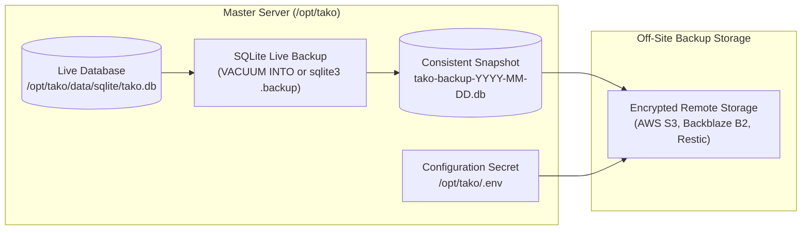

## Overview

Because the Tako master server relies on embedded SQLite rather than an external database cluster, the entire platform state (users, project configurations, encrypted environment variables, node registrations, domains, and deployment history) resides in a single database file.

---

## Backup Architecture



---

## What is Included in the Database Backup

The SQLite database (`tako.db`) contains:
- User accounts, hashed passwords, and session records.
- Projects, environments, and services configuration.
- Service domain routing and SSL metadata.
- AES-256-GCM encrypted service environment variables and secrets.
- Enrolled worker node records and enrollment tokens.
- Deployment history, execution steps, and build logs.
- Full system audit log history.

<Important>
The SQLite database backup contains cluster configuration, but **does not** contain application data stored inside Docker named volumes (such as PostgreSQL database directories or media files). Application volumes should be backed up using volume dump tools or database native commands.
</Important>

---

## Step 1: Create a Live Database Snapshot

Because SQLite operates in Write-Ahead Logging (WAL) mode, copying the `.db` file directly while transactions are active can produce an inconsistent file if WAL frames are still pending. Use one of the two standard online backup methods:

### Method A: Using SQLite `VACUUM INTO` (Recommended)

Run a clean snapshot command through Docker:

```bash
docker exec -t tako-server sqlite3 /data/tako.db \
  "VACUUM INTO '/data/backup-$(date +%Y%m%d-%H%M%S).db';"
```

The resulting file in `/opt/tako/data/sqlite/` is a guaranteed consistent, defragmented point-in-time snapshot of the database.

### Method B: Using the `sqlite3` Backup Command

```bash
docker exec -t tako-server sqlite3 /data/tako.db \
  ".backup '/data/backup-$(date +%Y%m%d-%H%M%S).db'"
```

---

## Step 2: Back Up the Encryption Keys (`.env`)

Encrypted environment variables stored in SQLite use the master key `TAKO_AUTH_SECRET`. If this key is lost, stored secrets cannot be decrypted upon restore.

Back up `/opt/tako/.env` securely alongside your database snapshot:

```bash
# Save to an encrypted off-site directory
cp /opt/tako/.env /backup/tako.env
```

---

## Disaster Recovery: Restoring on a Fresh Server

If the master server encounters hardware failure, you can rebuild the control plane on a clean Linux instance:

### 1. Install Tako on the New Server
Install the base master server using the standard installer:
```bash
curl -fsSL https://gettako.dev/install.sh | bash
```

### 2. Stop the Tako Services
```bash
cd /opt/tako && docker compose down
```

### 3. Restore Configuration & Database Files
Copy your backed-up `.env` file and database snapshot into `/opt/tako`:
```bash
# Restore master secrets
cp /backup/tako.env /opt/tako/.env

# Restore database snapshot
cp /backup/tako-backup.db /opt/tako/data/sqlite/tako.db
chmod 600 /opt/tako/data/sqlite/tako.db
```

### 4. Restart the Master Stack
```bash
cd /opt/tako && docker compose up -d
```

### 5. Automatic Worker Node Reconnection
As soon as DNS or IP routing for the master server is pointed to the new instance, connected worker nodes will automatically reconnect over gRPC, validate using the restored `TAKO_AGENT_SECRET`, and resume streaming telemetry.
