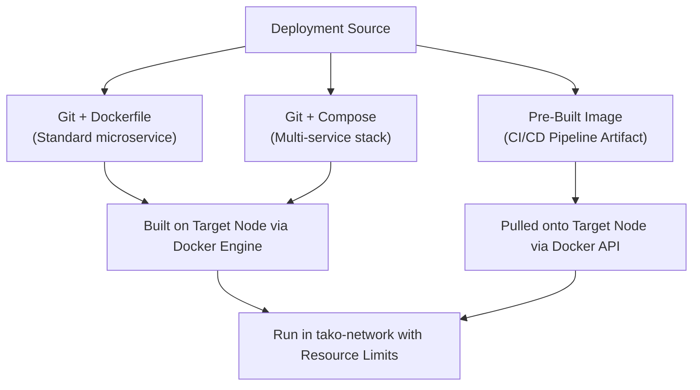

## Overview

Tako supports deploying workloads through three primary methods:
1. **Git Repository with Dockerfile:** Tako clones your repository, extracts commit metadata, and builds a container image locally on the worker node.
2. **Git Repository with Docker Compose:** For multi-container stacks running from a `docker-compose.yml` file.
3. **Pre-built Container Image:** Deploying directly from a container registry (Docker Hub, GitHub Container Registry, AWS ECR).

---

## Deployment Sources



---

## Method 1: Deploy from Git with Dockerfile

This is the standard deployment model for custom applications.

### Requirements
Your repository must contain a valid `Dockerfile` in the root directory or in a specified subpath.

```dockerfile
# Example Dockerfile (Node.js / Next.js)
FROM node:20-alpine AS builder
WORKDIR /app
COPY package*.json ./
RUN npm ci
COPY . .
RUN npm run build

FROM node:20-alpine AS runner
WORKDIR /app
ENV NODE_ENV=production
COPY --from=builder /app/package*.json ./
COPY --from=builder /app/node_modules ./node_modules
COPY --from=builder /app/.next ./.next
COPY --from=builder /app/public ./public
EXPOSE 3000
CMD ["npm", "run", "start"]
```

### Steps in Tako Console
1. Navigate to **Projects** and select your project.
2. Click **Add Service** and choose **Git Repository**.
3. Fill in the repository details:
   - **Repository URL:** `https://github.com/username/repository` (or SSH URL if configured).
   - **Branch:** `main` (or target release branch).
   - **Dockerfile Path:** `Dockerfile` (or e.g. `apps/web/Dockerfile`).
   - **Container Port:** `3000` (the port exposed in your Dockerfile).
4. Select the target node.
5. Click **Deploy**.

---

## Method 2: Deploy from Pre-Built Image

If your team builds and scans container images inside an external CI/CD pipeline (such as GitHub Actions or GitLab CI):

1. In the service creation form, select **Docker Image**.
2. Enter the full image reference:
   ```text
   ghcr.io/my-org/my-app:v1.2.4
   ```
3. If using a private registry, provide registry credentials in **Cluster Settings** or as deployment environment variables.
4. Specify the container port (e.g. `8080`).
5. Click **Deploy**. Tako pulls the image directly and launches the container without running local build steps.

---

## Resource Limits & Host Configuration

To protect host stability, Tako allows setting explicit CPU and memory constraints on every service:

- **CPU Limit:** Fractional CPU cores allowed (for example, `0.5` for half a core, `2.0` for two full cores). Implemented via Docker NanoCPUs.
- **Memory Limit (MB):** Hard RAM boundary (for example, `512` for 512 MB). If the container exceeds this limit, the Linux kernel terminates it with an OOM error, triggering an alert in Tako.
- **Swap Limit (MB):** Optional swap threshold to buffer temporary memory spikes.

### Port Exposure Options

- **Domain Routing (Default):** The container attaches to the bridge network `tako-network` without publishing ports on the host interface. Traefik routes traffic by matching Host headers.
- **Publish to Host:** When enabled, binds the container port directly to `0.0.0.0:<port>` on the host machine. Used for non-HTTP workloads (such as raw TCP game servers, MQTT brokers, or direct database connections).
