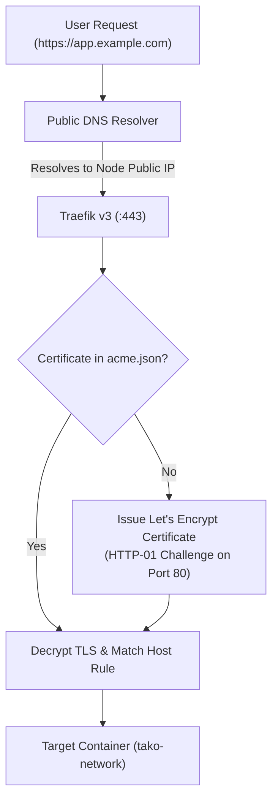

## Overview

Tako automates ingress domain routing and TLS certificate lifecycle management through its embedded Traefik v3 proxy. You can attach multiple custom domains to a service, enforce HTTPS redirection, and test preview builds using automatic `sslip.io` domains.

---

## Domain Routing Flow



---

## Step 1: Configure Your DNS Records

Before adding a domain in Tako, create the necessary DNS record with your DNS provider (Cloudflare, Namecheap, Route 53, Porkbun, etc.):

### Root / Apex Domain (e.g. `example.com`)
```text
Type  : A
Name  : @
Value : <TARGET_NODE_PUBLIC_IP>
TTL   : 300 (or Auto)
```

### Subdomain (e.g. `app.example.com`)
```text
Type  : A
Name  : app
Value : <TARGET_NODE_PUBLIC_IP>
TTL   : 300 (or Auto)
```

<Important>
Ensure the `A` record points to the public IP address of the **specific node** where your service is deployed, not necessarily the master server.
</Important>

---

## Step 2: Add Domain in Tako Console

1. Navigate to your service in the Tako Console.
2. Select the **Domains** tab.
3. Click **Add Domain**.
4. Enter your hostname (for example, `app.example.com`).
5. Ensure the **SSL (Let's Encrypt)** toggle is enabled.
6. Click **Save Domain**.

Tako immediately writes the new configuration file to `/etc/tako/traefik/dynamic`. Traefik reloads the configuration and initiates the certificate issuance process.

---

## Automatic Let's Encrypt Certificates

When a domain has SSL enabled:

1. **ACME Challenge:** Traefik contacts the Let's Encrypt staging/production API and answers an HTTP-01 challenge over port 80.
2. **Certificate Storage:** Issued X.509 certificates and private keys are saved securely in `/etc/tako/traefik/acme.json` with strict `0600` permissions.
3. **Automatic Renewal:** Certificates are renewed automatically 30 days before expiration. No cron jobs or certbot commands are required.

---

## Instant Wildcard Preview Domains (`sslip.io`)

Every service in Tako is automatically assigned a wildcard DNS domain on creation:

```text
http://<service-slug>-<node-dashed-ip>.sslip.io
# Example: http://api-server-198-51-100-24.sslip.io
```

Because `sslip.io` resolves the embedded IP address automatically via public DNS, you can access your deployed services immediately without waiting for DNS propagation or registering custom domain names.

---

## Troubleshooting Common Issues

### 1. Let's Encrypt Challenge Timed Out
- **Symptom:** The domain returns a self-signed or invalid certificate.
- **Cause:** Port 80 is blocked by your server firewall, or DNS records have not propagated.
- **Fix:** Verify port 80 is open to the public internet:
  ```bash
  sudo ufw allow 80/tcp
  ```
  Check DNS propagation using `dig` or `nslookup`:
  ```bash
  dig +short app.example.com
  ```

### 2. Cloudflare Proxy Conflicts
- If your domain uses Cloudflare, set the proxy status to **DNS Only** (gray cloud) during initial certificate issuance, or ensure Cloudflare SSL/TLS encryption mode is set to **Full (Strict)**.
