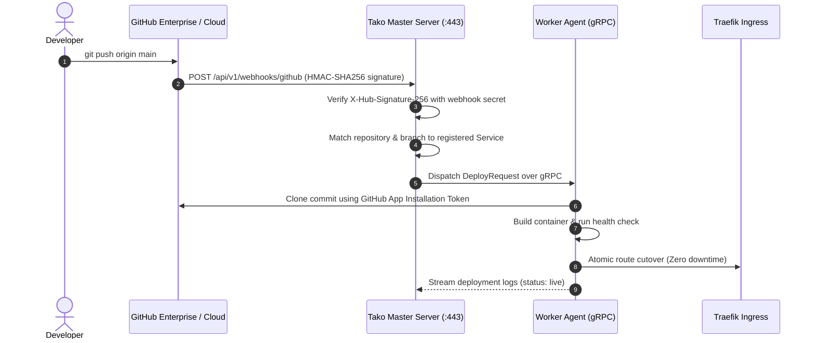

## Overview

Tako features native integration with GitHub through the official **GitHub App Manifest flow**. Instead of manually generating and rotating personal access tokens (PAT) or creating deploy keys for every single repository, connecting a GitHub App gives Tako scoped, secure access to your public and private repositories.

With GitHub integration enabled, pushing a commit to your configured branch (such as `main` or `production`) automatically triggers a zero-downtime deployment pipeline in Tako.

---

## Webhook & Deployment Flow

---

## Step 1: Connect GitHub in Tako Console

Tako implements the GitHub App Manifest flow, which configures permissions and generates RSA private keys automatically without manual copy-pasting:

1. Log into your Tako Console.
2. In the sidebar, navigate to **Settings** and select the **GitHub** tab.
3. Click **Connect GitHub App**.
4. You will be redirected to GitHub's authorization page.
5. Review the requested permissions:
   - **Repository contents:** Read-only (to clone code and Dockerfiles).
   - **Commit statuses:** Read & write (to report build status on commits).
   - **Webhooks:** Push events and pull request triggers.
6. Choose whether to grant access to **All repositories** or **Only select repositories**.
7. Click **Create GitHub App**. GitHub will redirect back to your Tako Console with the credentials securely encrypted into SQLite.

---

## Step 2: Deploy a Service from GitHub

Once connected, your authorized repositories appear automatically when creating or configuring services:

1. Open your project in the Tako Console and click **Add Service**.
2. Select **GitHub Repository**.
3. Choose your repository from the pre-populated dropdown list (both public and private repositories are accessible).
4. Select the target deployment **Branch** (for example, `main`).
5. Specify the **Dockerfile Path** (default: `Dockerfile`, or e.g. `apps/api/Dockerfile` for monorepos).
6. Set the internal container port (e.g. `3000`).
7. Enable the toggle **Auto-Deploy on Git Push**.
8. Click **Deploy**.

---

## Step 3: Webhook Security & Signature Verification

Tako verifies every incoming webhook from GitHub to prevent unauthorized build triggers:

- **HMAC-SHA256 Verification:** GitHub computes a cryptographic hash of the webhook payload using a shared pre-shared secret and transmits it in the `X-Hub-Signature-256` header.
- **Enforced Rejection:** The Tako master server computes the expected HMAC signature using the stored `github_webhook_secret`. If the signature does not match or is absent, Tako rejects the request immediately with HTTP `401 Unauthorized`.
- **Event Filtering:** Tako processes `push` events matching the configured service branch. Commits pushed to other branches are safely acknowledged and ignored without triggering unnecessary container builds.

---

## Deploying Monorepos

If your team maintains multiple microservices within a single Git repository:

1. Create a distinct Tako service for each component (e.g., `web-frontend`, `auth-api`, `worker`).
2. Point all services to the same GitHub repository and branch.
3. In each service configuration, set the explicit path to its `Dockerfile`:
   - Service 1: `apps/web/Dockerfile`
   - Service 2: `services/api/Dockerfile`
   - Service 3: `workers/queue/Dockerfile`
4. Set the **Build Context** directory to match the root of each app (e.g., `apps/web`).

When a commit touches the repository, Tako triggers the respective deployment pipelines independently.
