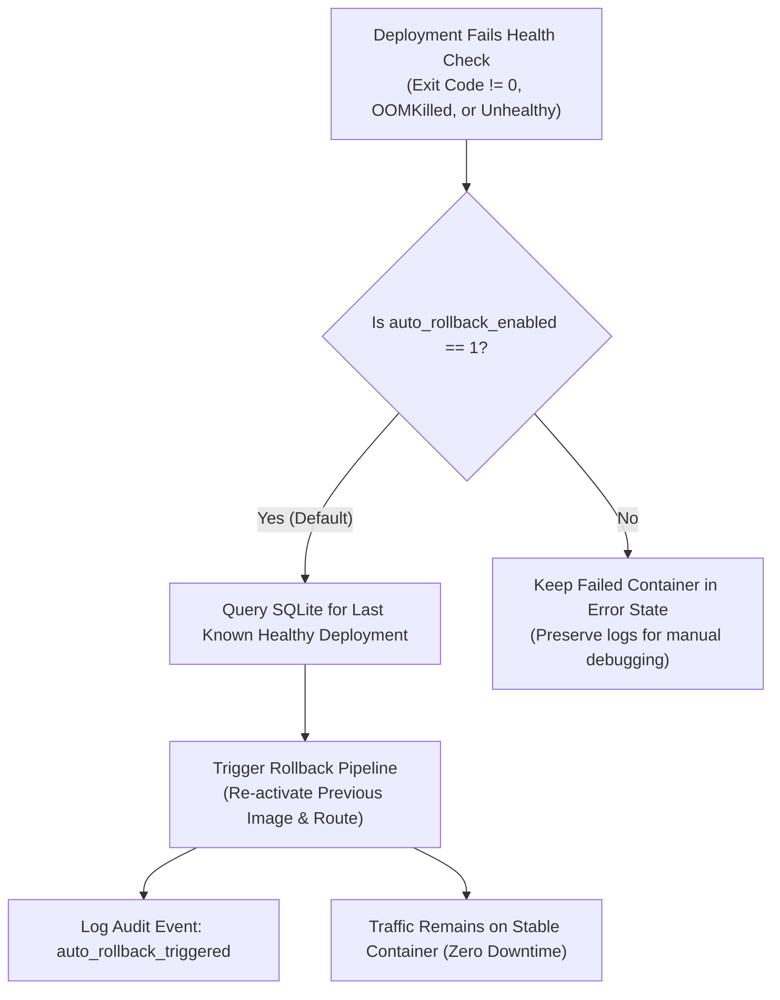

## Overview

In production web applications, regressions, missing environment keys, or breaking runtime errors can cause new releases to fail after deployment. Tako provides two complementary recovery mechanisms:

1. **Automated Rollback:** Detects failed container health checks immediately during the deployment pipeline and reverts traffic before public users are impacted.
2. **Instant Manual Rollback:** Allows operators to revert a live service to any previous healthy deployment from history in a single click.

---

## Rollback Decision Architecture



---

## 1. Automated Rollback on Health Check Failure

By default, every service in Tako has auto-rollback enabled (`auto_rollback_enabled: 1`).

### Failure Detection Loop
During the `Health check` stage of the deployment pipeline, the Tako agent probes the container up to 8 times across several seconds:
- **Premature Exit:** If the process crashes immediately upon startup (for example, missing database credentials).
- **OOM Kill:** If the container violates memory boundaries and is terminated by the kernel.
- **Unhealthy Status:** If a defined Dockerfile `HEALTHCHECK` probe returns a failure code.

### Execution Sequence
1. The agent marks the health check step as `failed` and cleans up the temporary preview route file (`<service>-<commit8>.yml`).
2. The master server catches the failure event and queries the SQLite database for the most recent deployment that completed in `live` status.
3. If a stable deployment exists, the orchestrator triggers an automatic rollback:
   ```text
   [15:10:04] [Health check] Health check FAILED: container exited prematurely with code 1
   [15:10:05] [Auto-Rollback] Health check failure detected. Automatically triggering rollback to previous stable deployment: dep-4a8b1c (commit 7e2f1a)...
   ```
4. The audit log records an `auto_rollback_triggered` entry detailing the failed deployment, the restored deployment target, and the reason.

### Disabling Auto-Rollback for Debugging
If you are troubleshooting a tricky deployment issue and want the failed container to remain running for inspection via `docker logs` or interactive exec:
1. Open your service in the Tako Console.
2. Go to **Settings**.
3. Toggle off **Auto-Rollback on Health Failure**.
4. Click **Save Settings**.

---

## 2. Instant Manual Rollback

If a bug is discovered after a deployment has successfully passed initial health checks, you can revert to any prior release:

1. Open your service in the Tako Console and select the **Deployments** tab.
2. Review the list of past deployments. Each card displays the commit hash, commit message, author, and execution timestamp.
3. Locate the previous stable deployment and click **Rollback to This Version**.
4. Confirm the prompt.

### Why Rollbacks are Instant
Because Tako builds and tags images with their commit hash locally (`tako/<service-slug>:<commit8>`), the previous container image is already cached on the worker node. Tako does not need to re-clone the repository or re-run build commands. It spins up the cached image, validates readiness, and updates Traefik routing in seconds.
