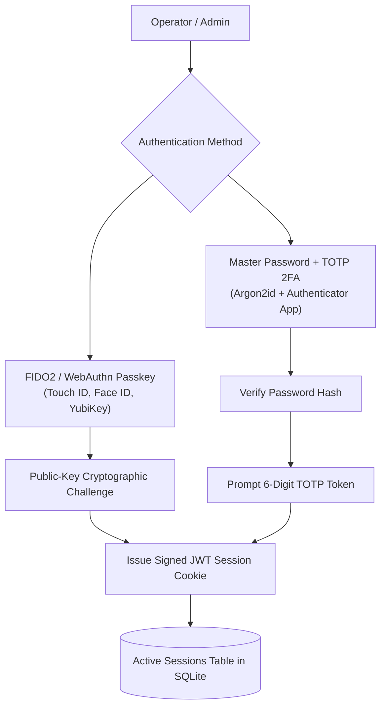

## Overview

Tako is designed with security-first defaults. From hardware-backed biometric authentication to cryptographic secret encryption, the platform provides tools to protect both your control plane and deployed workloads.

---

## Authentication Architecture



---

## 1. Passwordless Passkeys (WebAuthn / FIDO2)

Tako provides native support for **Passkeys** based on the W3C WebAuthn standard. You can sign in using Touch ID, Face ID, Windows Hello, or hardware security keys (like YubiKey) without transmitting passwords across the network:

### Registering a Passkey
1. Log into the Tako Console.
2. In the top right corner, click your user avatar and select **Profile & Security**.
3. Under the **Passkeys** section, click **Register New Passkey**.
4. Provide a friendly name for your device (such as `MacBook Pro Touch ID` or `Primary YubiKey 5C`).
5. Your browser or operating system will prompt you to complete biometric verification or touch your hardware key.
6. Once registered, the public key credential is encrypted into SQLite.

### Signing In with Passkeys
On the login screen, click **Sign in with Passkey**. Your browser will immediately prompt for biometric confirmation, authenticating you directly without entering an email or password.

---

## 2. Two-Factor Authentication (TOTP)

For accounts using standard password authentication, Tako supports Time-based One-Time Password (TOTP) two-factor authentication:

1. In **Profile & Security**, navigate to **Two-Factor Authentication**.
2. Click **Enable 2FA**.
3. Scan the displayed QR code with your authenticator application (Google Authenticator, 1Password, Bitwarden, Authy).
4. Enter the current 6-digit confirmation code generated by your app.
5. Save your generated emergency recovery backup codes in a secure location.
6. Once enabled, every password login requires both your password and a valid 6-digit TOTP token.

---

## 3. Session Management & Remote Revocation

Tako tracks every active session token with metadata including IP address, user agent, login time, and last active timestamp:

- **Review Active Sessions:** In **Profile & Security**, view all active devices currently authenticated to your account.
- **Revoke Suspicious Sessions:** Click **Revoke** on any individual session to invalidate its session cookie immediately.
- **Revoke All Other Sessions:** Click **Sign out all other devices** to terminate all sessions except your current browser session.

---

## 4. Host Firewall & Network Hardening

Because Tako utilizes an outbound-only agent architecture, you can significantly reduce the attack surface of your server infrastructure.

### Master Server Ports
```bash
# Allow web traffic and Let's Encrypt challenges
sudo ufw allow 80/tcp
sudo ufw allow 443/tcp

# Allow gRPC agent connections (optionally restrict to known worker IPs)
sudo ufw allow 50051/tcp

# Enable firewall
sudo ufw enable
```

### Worker Node Ports
Worker nodes only serve incoming HTTP/S web traffic for their hosted containers. **They do not require inbound management ports:**

```bash
# Allow web traffic for hosted services
sudo ufw allow 80/tcp
sudo ufw allow 443/tcp

# Close SSH or restrict port 22 to internal VPN
# No inbound port 50051 or Docker daemon ports required!
sudo ufw enable
```

---

## 5. Secret Encryption Hygiene

- All environment variables marked as **Secret** are encrypted using **AES-256-GCM** before being written to SQLite.
- The encryption key is derived from `TAKO_AUTH_SECRET` in `/opt/tako/.env`. Ensure this file has strict filesystem permissions (`chmod 600 /opt/tako/.env`) and is included in your off-site backups.
