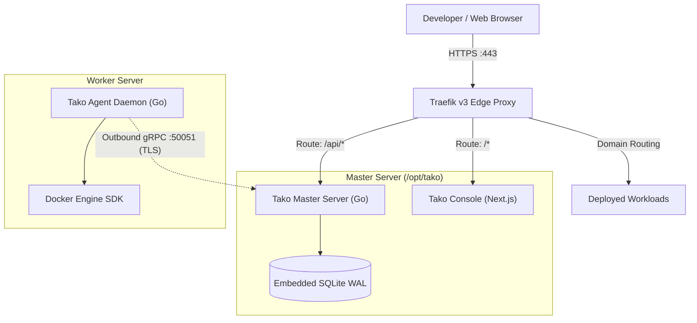

## What is Tako?

Tako is an open-source, self-hosted deployment platform designed to run web applications and background services across one or more Linux servers. It provides the ergonomics of a modern platform-as-a-service (PaaS) without requiring heavy background database daemons, container registries, or open management ports on worker servers.

Traditional self-hosted PaaS solutions offer extensive feature sets, but often require significant operational overhead. Many platforms require multiple infrastructure containers (such as dedicated PostgreSQL, Redis, or queue workers) just to run their control panel. In addition, managing remote worker servers often involves granting root SSH access over the public internet.

Tako approaches self-hosting with a different set of priorities:

- **Static Go control plane:** The master server runs as a single Go binary with an embedded SQLite database in Write-Ahead Logging (WAL) mode. The entire master stack idles at less than 50 MB of RAM.
- **Outbound-only worker nodes:** Worker nodes run a lightweight Go daemon that establishes an outbound gRPC stream over TLS to the master server. Remote worker nodes require zero inbound management ports and no open SSH port 22.
- **Dynamic Traefik v3 routing:** Edge routing, zero-downtime cutover gates, and automatic Let's Encrypt TLS certificate provisioning run through local Traefik instances configured dynamically.
- **Standard Docker tooling:** Deployments run directly on the local Docker Engine using standard `Dockerfile` or `docker-compose.yml` configurations, without requiring custom buildpack abstractions.

---

## High-Level Topology

In this architecture:

1. **Master Node:** Hosts the HTTP API (`tako-server`), the web dashboard (`tako-console`), an embedded SQLite database, and an edge Traefik instance.
2. **Worker Nodes:** Run the `tako-agent` daemon. Each daemon dials out to the master server over gRPC (port 50051) and listens for deployment instructions, telemetry requests, and log streaming commands.
3. **Workload Containers:** The agent interfaces directly with the local Docker daemon over the unix socket (`/var/run/docker.sock`) to build images, provision containers, and manage routing files.

---

## Design Principles

Tako is guided by four technical principles:

### 1. Predictable Resource Consumption
Small virtual private servers (such as 1 GB or 2 GB RAM droplets) should not spend half their memory running platform control services. Tako uses Go binaries compiled without heavy runtime dependencies and stores all relational state in an embedded SQLite database.

### 2. Reduced Attack Surface on Remote Nodes
Traditional orchestration tools connect into remote nodes using SSH keys or exposed HTTP agent endpoints. Tako flips this model: worker nodes initiate outbound connections to the master server. A worker node can sit behind carrier-grade NAT or a private subnet without requiring a public IP or port forwarding.

### 3. Native Docker Primitives
Tako avoids proprietary build pipelines. Every project is built from a standard `Dockerfile` or composed with `docker-compose.yml`. What builds locally in Docker builds identically on Tako.

### 4. Zero-Downtime Deployment Gates
Every deployment starts the new container version under an isolated preview route while the previous version continues handling live traffic. Traefik promotes public traffic to the new container only after container health checks succeed.

---

## Next Steps

- Review the [Philosophy and Motivations](/why-tako) behind Tako.
- Install the master server and connect your first node in the [Quickstart Guide](/quickstart/installation).
- Learn about the system internals in [Architecture Overview](/architecture/overview).
