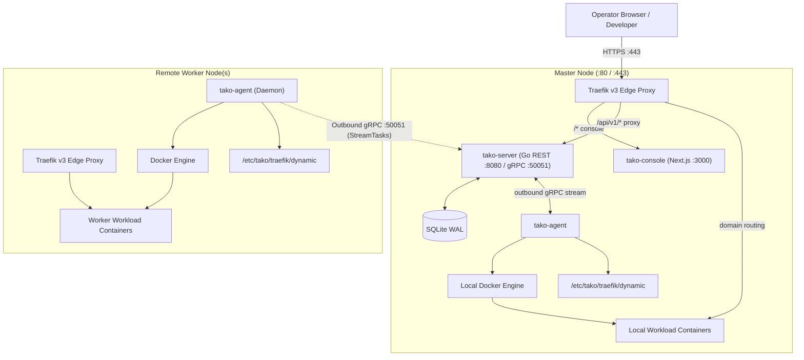

## What is Tako?

**Tako** is a modern, open-source, self-hosted Platform-as-a-Service (PaaS). It schedules, builds, and runs web applications and background workloads across one or more Linux servers with the developer ergonomics of modern cloud platforms (like Vercel or Render), but running entirely on your own infrastructure.

Traditional self-hosted deployment tools often carry heavy operational baggage:
- They require multiple bulky services (PostgreSQL, Redis, RabbitMQ, Celery/BullMQ) just to run their control panel.
- Connecting worker nodes usually requires opening inbound SSH port 22 or exposing insecure HTTP daemon ports to the public internet.
- High memory footprint: idling control panels frequently consume 1 GB to 2 GB of RAM before running a single user workload.

Tako approaches self-hosting with a modern systems architecture:

- **Ultra-Lean Go Control Plane:** The master orchestrator (`tako-server`) runs as a single compiled Go binary backed by an embedded SQLite database in WAL (Write-Ahead Logging) mode. The entire master control plane idles at under 50 MB RAM.
- **Outbound-Only Worker Architecture:** Worker nodes run a lightweight Go daemon (`tako-agent`) that dials out to the master server over a persistent, multiplexed gRPC connection. Remote worker nodes require **zero inbound management ports and no open SSH port 22**. They work transparently behind NAT, residential IPs, and strict firewalls.
- **Edge Routing with Traefik v3:** Dynamic reverse proxying, zero-downtime cutover gates, and automatic Let's Encrypt SSL/TLS certificates run through Traefik v3 without manual configuration.
- **Modern Web Console:** Built with Next.js 16 (App Router), React 19, and Tailwind CSS, providing an interactive dashboard, real-time log streaming, and an in-browser container terminal.

---

## High-Level Topology

---

## Key Capabilities

<CardGroup cols={2}>
  <Card title="Zero-Downtime Deployments" icon="shield-check">
    Automatic health check gates with dynamic Traefik preview routing. New versions are promoted only when healthy; failed deployments automatically roll back.
  </Card>
  <Card title="Multi-Node Clustering" icon="server">
    Add remote worker servers across any cloud provider, VPS, or bare metal with a single enrollment command.
  </Card>
  <Card title="Interactive Web Terminal" icon="terminal">
    Execute commands directly inside running containers from your browser with xterm.js, tab autocompletion, and virtual file navigation.
  </Card>
  <Card title="Live Log Streaming" icon="lines-leaning">
    Real-time Server-Sent Events (SSE) log streaming with ANSI color decoding for deployment builds and container runtimes.
  </Card>
  <Card title="Git & GitHub App Integration" icon="github">
    Connect private GitHub repositories using official GitHub App manifests for instant push-to-deploy webhooks.
  </Card>
  <Card title="Automated S3 Backups" icon="database">
    Automatic SQLite database snapshots and scheduled backups to any S3-compatible object storage (AWS, Cloudflare R2, MinIO, Wasabi).
  </Card>
  <Card title="Passkeys & WebAuthn" icon="fingerprint">
    Hardware security key and biometric authentication (Face ID, Touch ID, YubiKey) alongside password protection.
  </Card>
  <Card title="Scheduled Crons & Webhooks" icon="clock">
    Manage container cron jobs and trigger automated redeployments via secure HTTP webhooks.
  </Card>
</CardGroup>

---

## Next Steps

<CardGroup cols={2}>
  <Card title="Quickstart Installation" icon="rocket" href="/quickstart/installation">
    Install Tako Master and connect your first node in less than 2 minutes.
  </Card>
  <Card title="Why Tako?" icon="lightbulb" href="/why-tako">
    Explore the design philosophy and technical decisions behind Tako.
  </Card>
  <Card title="Architecture Internals" icon="cpu" href="/architecture/overview">
    Learn how the control plane, worker agent, and edge proxy interact.
  </Card>
  <Card title="System Configuration" icon="sliders" href="/reference/configuration">
    Complete environment variables and operational parameters.
  </Card>
</CardGroup>
