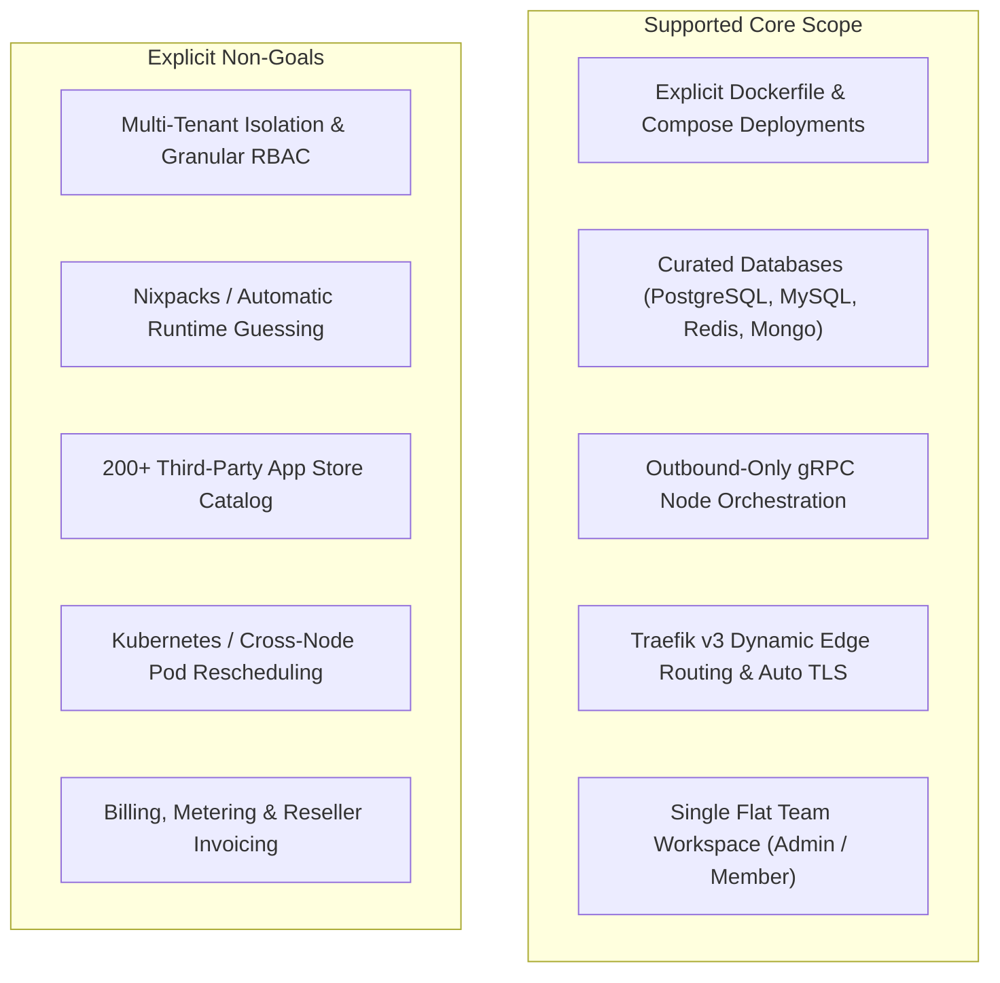

## Understanding Architectural Boundaries

A well-architected system is defined as much by what it chooses not to do as by what it implements. Tako is intentionally scoped for solo developers, small engineering teams, and homelab operators who want low platform overhead.

The boundaries detailed below are deliberate architectural choices rather than temporary omissions.

---

## 1. Single Flat Workspace (No Multi-Tenancy or Custom RBAC)

Tako operates on a single flat workspace model. Authenticated accounts are assigned one of two predefined roles:

- **Admin:** Complete access to cluster nodes, system settings, user invitations, and all projects.
- **Member:** Can deploy services, view logs, and configure environment variables, but cannot enroll servers or invite other users.

Tako intentionally does not include:
- Multi-tenant tenant isolation for running separate client organizations on a single installation.
- Granular Role-Based Access Control (RBAC) matrices (such as per-project or per-environment permissions).
- Single Sign-On (SSO) SAML integration.

Organizations requiring isolated multi-tenancy or complex departmental permission structures should choose an enterprise platform.

---

## 2. No Commercial Billing or Reseller Metering

Tako is designed for hosting your own infrastructure, not for selling hosting services to external customers. As a result:

- There is no billing integration (Stripe, Lemon Squeezy, Paddle).
- There is no usage metering, credit deduction, or quota invoicing.
- There are no rate-limiting tiers tied to subscription plans.

---

## 3. Explicit Dockerfile & Compose Builds (No Nixpacks or Buildpacks)

All source code builds in Tako require an explicit `Dockerfile` or `docker-compose.yml` file in the repository root or a specified path.

- **No Nixpacks:** Tako does not attempt to inspect source code and guess language runtimes, package managers, or start commands.
- **No Cloud Native Buildpacks (CNB):** Buildpacks add image layering complexity, larger final image sizes, and opaque build failures.
- **Explicit configuration:** Using a standard `Dockerfile` ensures reproducible builds that behave identically on local developer machines and production nodes.

---

## 4. No 200+ Third-Party Application Catalog

Tako does not include an extensive community app store containing hundreds of third-party apps (such as WordPress, Nextcloud, or Ghost).

- Tako provides curated infrastructure templates for relational and in-memory databases (PostgreSQL, MySQL, Redis, MongoDB).
- Application workloads are deployed from your own Dockerfiles or Compose files.
- Avoiding third-party application catalogs prevents maintenance overhead caused by deprecated upstream image tags and breaking configuration changes.

---

## 5. Direct Docker Engine Scheduling (No Kubernetes or Swarm)

Tako schedules containers directly onto local Docker Engine instances (Docker 24.0 or newer).

- **No Kubernetes:** Tako does not interact with Kubernetes APIs, Helm charts, or CRDs.
- **No Docker Swarm:** Tako does not configure overlay network meshes (VXLAN) across worker nodes.
- **Static service assignment:** Each service is explicitly assigned to a designated server node. If that host encounters a physical hardware failure, containers do not automatically reschedule to another node. Failover must be handled via DNS or manual reassignment.

---

## 6. Embedded SQLite Database Engine

The control plane stores relational records in an embedded SQLite database using Write-Ahead Logging (WAL) and AES-256-GCM encryption for credentials.

- **No external database cluster:** Tako does not connect to external PostgreSQL or CockroachDB clusters.
- **Single-writer serialization:** SQLite handles high-concurrency reads with microsecond latency, but serializes write transactions. While ideal for personal projects and small teams, it is not architected for hundreds of concurrent control plane API mutations per second.

---

## 7. Linux Host Requirement

Both the Tako Master Server and the Tako Worker Agent require a Linux operating system (such as Ubuntu, Debian, Rocky Linux, AlmaLinux, or Alpine) with:
- Systemd or OpenRC process management.
- Access to the Docker daemon unix socket (`/var/run/docker.sock`).
- Network access to pull base container images.

Windows Server and native macOS daemons are not supported for production node deployments.

---

## Boundary Summary

