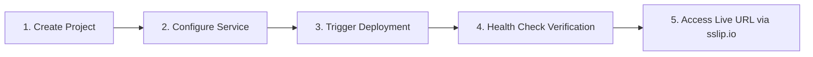

## Overview

In Tako, applications are organized into **Projects** and **Services**:

- **Project:** A logical grouping representing an application stack or environment (such as `production` or `staging`).
- **Service:** An individual container workload within a project, assigned to a specific server node and configured with Git repository settings, ports, environment variables, and domains.

---

## Deployment Journey



---

## Step 1: Create a Project

1. Log into the Tako Console at `https://<YOUR_SERVER_IP>` (or port 3000).
2. Click **New Project** on the dashboard.
3. Enter a project name (for example, `My Web App`) and choose an environment (`production` or `staging`).
4. Click **Create Project**.

---

## Step 2: Add a Service

Within your newly created project:

1. Click **Add Service**.
2. Select your deployment source:
   - **Git Repository:** Enter your repository URL (such as `https://github.com/example/my-node-app`), branch (e.g., `main`), and the path to your `Dockerfile`.
   - **Pre-built Docker Image:** Enter a public or private container image tag (such as `ghcr.io/example/my-app:v1.0.0`).
3. Select the **Target Node**: Choose whether this service runs on the master node or on an enrolled worker node.
4. Define the **Container Port**: Specify the internal port your container listens on (such as `3000` for Next.js, `8080` for Go, or `80` for NGINX).

---

## Step 3: Configure Environment Variables

If your application requires runtime configuration:

1. Navigate to the **Environment** tab in the service view.
2. Add your key-value pairs (for example, `NODE_ENV=production` or `DATABASE_URL=postgres://...`).
3. Toggle the **Secret** switch for sensitive tokens, passwords, or private keys. Secrets are encrypted using AES-256-GCM before storage in SQLite.
4. Click **Save Changes**.

---

## Step 4: Trigger the Deployment

Click **Deploy** in the top-right corner of the service interface.

Tako streams real-time execution logs and updates the step status cards as the pipeline progresses:

```
[15:04:02] [Queued] Deployment dep-8f92a1 initialized for service web-frontend
[15:04:03] [Clone] Cloning https://github.com/example/my-node-app.git (branch: main)...
[15:04:05] [Clone] HEAD commit 4a8b1c9: fix: update landing header (by developer)
[15:04:06] [Build] Running docker build with Dockerfile...
[15:04:22] [Push/Load image] Image tako/web-frontend:4a8b1c9 ready for deployment
[15:04:23] [Deploy] Prepared Traefik routing rules for domains
[15:04:24] [Deploy] Container tako-app-web-frontend-4a8b1c9 started successfully
[15:04:25] [Health check] Verifying service container status...
[15:04:27] [Health check] Health check passed: container is running and stable
[15:04:28] [Deploy] Canonical domain routing updated to tako-app-web-frontend-4a8b1c9
[15:04:29] [Live] Service web-frontend is live and ready to receive traffic!
```

---

## Step 5: Verify Live Traffic & Preview Domains

Every service in Tako receives an automatic wildcard DNS domain using `sslip.io` based on the target node IP address:

```
http://<service-slug>-<node-dashed-ip>.sslip.io
# Example: http://web-frontend-198-51-100-24.sslip.io
```

You can open this URL immediately in your browser to verify your running application without configuring manual DNS records.

---

## Step 6: Add a Custom Domain & Enable SSL

When you are ready to bind a production domain:

1. In your DNS provider (Cloudflare, Namecheap, Route 53, etc.), create an `A` record pointing your domain or subdomain to your server's public IP address:
   ```text
   Type : A
   Name : app (or @)
   Value: <YOUR_SERVER_PUBLIC_IP>
   ```
2. In the Tako Console, open your service and click **Domains**.
3. Click **Add Domain** and enter your hostname (for example, `app.example.com`).
4. Keep the **SSL (Let's Encrypt)** toggle enabled.
5. Click **Save Domain**.

Traefik immediately registers the domain, issues an HTTP-01 challenge to Let's Encrypt, retrieves a TLS certificate, and enables HTTPS traffic.
