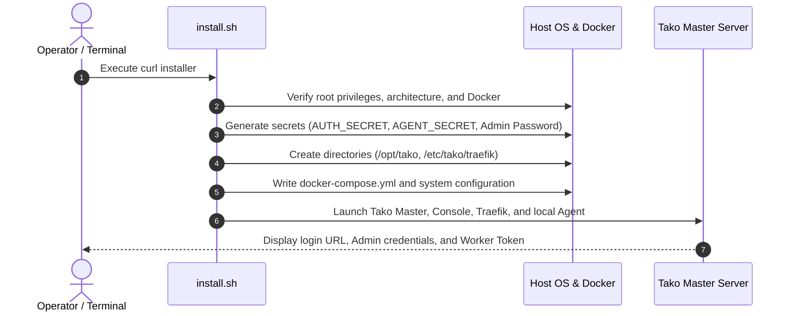

## System Requirements

Before installing Tako, ensure your target Linux host meets the following baseline requirements:

| Component | Minimum | Recommended |
| :--- | :--- | :--- |
| **Operating System** | Linux (Ubuntu 22.04+, Debian 12+, Rocky/AlmaLinux 9+, Alpine 3.19+) | Ubuntu 24.04 LTS or Debian 12 |
| **CPU Architecture** | x86_64 (amd64) or ARM64 (aarch64) | x86_64 or ARM64 |
| **CPU Cores** | 1 vCPU | 2 vCPU |
| **System Memory (RAM)** | 1 GB | 2 GB or more |
| **Disk Space** | 10 GB SSD / NVMe | 25 GB or more |
| **Docker Engine** | Docker 24.0+ and Docker Compose v2 | Docker 26.0+ |

<Note>
The Tako installer script automatically installs Docker Engine and Docker Compose if they are not already detected on the system.
</Note>

---

## Network & Firewall Requirements

### Master Server Ports

| Port | Protocol | Direction | Purpose | Access |
| :--- | :--- | :--- | :--- | :--- |
| **80** | TCP | Inbound | HTTP web traffic and Let's Encrypt ACME challenges | Public Internet |
| **443** | TCP | Inbound | HTTPS web traffic, Tako Console, and user apps | Public Internet |
| **50051** | TCP | Inbound | gRPC endpoint for worker agent connections | Worker Node IPs (or Public) |
| **22** | TCP | Inbound | SSH administrative host access | Restricted / Management Only |

### Worker Node Ports

| Port | Protocol | Direction | Purpose | Access |
| :--- | :--- | :--- | :--- | :--- |
| **80** | TCP | Inbound | HTTP web traffic for hosted workloads | Public Internet |
| **443** | TCP | Inbound | HTTPS web traffic and TLS termination | Public Internet |
| **50051** | TCP | Outbound | Bidirectional gRPC stream to Master Server | Destination: Master IP |

<Important>
Worker nodes do not require inbound port 50051 or inbound SSH port 22 open to the master server. The agent initiates an outbound TLS connection to the master.
</Important>

---

## Installation Pipeline



---

## Step 1: Install the Master Server

Log into your master server via SSH with `root` or `sudo` access, and run the universal installer:

```bash
curl -fsSL https://gettako.dev/install.sh | bash
```

### Non-Interactive Master Installation

For automated or scripted deployments, you can pass environment variables directly:

```bash
curl -fsSL https://gettako.dev/install.sh | TAKO_EMAIL="admin@example.com" TAKO_PASSWORD="your-secure-password" bash
```

During installation, the script performs the following actions:
1. Validates host architecture (`amd64` or `arm64`) and kernel compatibility.
2. Creates the base application directory at `/opt/tako` and dynamic routing paths at `/etc/tako/traefik`.
3. Generates cryptographically secure keys for authentication and node enrollment.
4. Initializes the local Traefik v3 reverse proxy with Let's Encrypt ACME support.
5. Builds and launches the `tako-server`, `tako-console`, and local `tako-agent` containers.

Once completed, the terminal outputs your access credentials:

```text
==================================================
Tako Master Server Installed Successfully
==================================================
Console URL      : https://your-server-ip
Admin Email      : admin@example.com
Admin Password   : [Generated Password]
Worker Token     : [Random 32-character Token]
Working Dir      : /opt/tako
==================================================
```

---

## Step 2: Access the Tako Console

Open your web browser and navigate to your master server's public IP or assigned domain:

```
http://<MASTER_SERVER_IP>:3000
# Or via HTTPS if Traefik domain routing is configured
https://<MASTER_SERVER_IP>
```

Log in using the administrator email and password output by the installer script.

---

## Step 3: Connect Worker Nodes (Optional)

If you wish to distribute container workloads across multiple physical servers or VPS instances, install the Tako Agent on each remote worker node.

Log into the worker server and run:

```bash
curl -fsSL https://gettako.dev/install.sh | bash -s -- \
  --agent \
  --token "<WORKER_TOKEN>" \
  --master "<MASTER_PUBLIC_IP>:50051"
```

Replace:
- `<WORKER_TOKEN>`: The enrollment token printed by the master installer (also viewable under **Cluster Settings** in the Console).
- `<MASTER_PUBLIC_IP>`: The public IP address or hostname of your master server.

The worker agent will automatically establish an outbound gRPC stream to the master server, register its CPU, memory, and disk capacity, and appear as **Online** in the Tako Console within seconds.

---

## Service Control Commands

Tako manages its core services using standard Docker Compose in `/opt/tako`:

```bash
# View running core services
cd /opt/tako && docker compose ps

# Inspect master server logs
cd /opt/tako && docker compose logs -f server

# Inspect edge proxy logs
cd /opt/tako && docker compose logs -f traefik

# Restart the Tako stack
cd /opt/tako && docker compose restart
```
