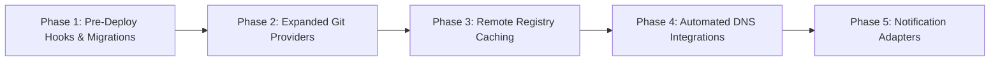

<Note>
**Status Notice:** The features outlined below represent planned milestones and active design proposals. They are not yet implemented in current Tako releases.
</Note>

Tako evolves strictly according to its core architectural philosophy: maintaining a lightweight footprint, single-binary simplicity, and zero unnecessary operational bloat.

---

## Planned Development Milestones

### 1. Pre-Deployment Database Migration Hooks

Executing database migrations safely before cutting over production web traffic:

- **Ephemeral migration containers:** Before promoting a new container version to live traffic, Tako will spin up a short-lived container running a defined command (such as `npx prisma migrate deploy`, `php artisan migrate --force`, or `alembic upgrade head`).
- **Gated traffic cutover:** If the migration command exits with a non-zero code, the deployment aborts immediately. The existing production container remains live and untouched, preventing partial schema states from disrupting active users.

### 2. Expanded Git Host Integrations

Currently, Tako integrates directly with GitHub via GitHub Apps and Personal Access Tokens. Future releases will add support for:

- **GitLab:** Native support for GitLab.com and self-hosted GitLab Community / Enterprise Edition instances, including commit status reporting and webhook handling.
- **Gitea / Forgejo:** Lightweight self-hosted git platform webhooks for completely offline or air-gapped environments.
- **Bitbucket Cloud:** Push webhook handling and automated build triggers.

### 3. Remote Registry Caching & Image Distribution

Currently, application container images are built locally on the target worker node where the service runs. Future improvements include:

- **Centralized build runners:** Ability to designate a high-compute worker node as a dedicated build runner.
- **Private registry distribution:** Support for pushing built images to private registries (GitHub Container Registry, Docker Hub, AWS ECR, or self-hosted Harbor/Docker Registry) and pulling pre-built images onto worker nodes, eliminating duplicate builds across multiple replica nodes.

### 4. Automated DNS Provider Integrations

Currently, operators configure DNS `A` records manually to point custom domains to a server's public IP address. Planned capabilities:

- **DNS API integrations:** Support for automated record management with providers such as Cloudflare, Hetzner DNS, AWS Route 53, and DigitalOcean DNS.
- **Automated preview records:** Automatically create and prune DNS records for dynamic commit-based preview environments.

### 5. Additional Notification Channels

Tako currently integrates natively with GitHub Webhooks for automated deployments and status checks. Planned outbound alert adapters include:

- **Discord & Telegram:** Native bot notifications and webhook channels with rich deployment status summaries.
- **Slack:** Structured Slack incoming webhooks with color-coded deployment status cards.
- **Generic Webhook Dispatcher:** Configurable JSON HTTP POST payloads for integration with automation tools like n8n, Zapier, or internal incident management platforms.
- **SMTP Email Notifications:** Standard email alerts for critical node health failures and automated rollbacks.

---

## Permanent Architectural Non-Goals

To maintain long-term stability and prevent code complexity sprawl, the following will not be added to Tako:

1. **No Kubernetes orchestration:** Tako will remain built directly on standard Docker Engine.
2. **No commercial billing or reseller modules:** Tako will not include customer billing or usage invoicing.
3. **No 200+ app store catalog:** Tako will not maintain unmaintained third-party community image catalogs.
4. **No multi-tenant organization boundaries:** Tako will maintain a shared flat workspace for trusted collaborators.
