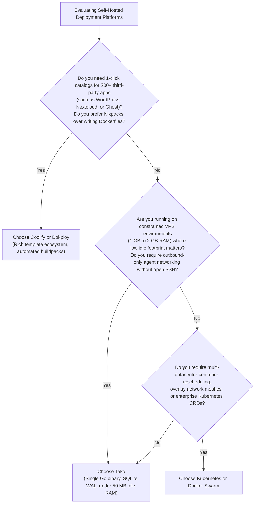

## Philosophy & Core Motivation

Self-hosting platforms such as Coolify and Dokploy have demonstrated that developers want the convenience of a modern cloud platform on their own virtual private servers. Both projects have built active communities and provide comprehensive suites of tools for managing infrastructure.

Tako was built to explore a distinct architectural position: **extreme minimalism with single-binary efficiency**.

When evaluating self-hosted tooling on budget virtual private servers (such as 1 GB or 2 GB RAM instances), the baseline overhead of the platform itself becomes a primary operational constraint. Running a management stack that requires dedicated PostgreSQL instances, Redis queues, and runtime processes can consume 500 MB to 1.5 GB of RAM before a single user application has been launched.

Tako focuses on running custom applications with minimal platform overhead, using three architectural design decisions:

1. **Single static Go binary control plane:** The master server runs without an external database server or interpreted language runtime.
2. **Embedded SQLite in WAL mode:** Database operations use modern SQLite with Write-Ahead Logging and AES-256-GCM encryption for stored secrets. Relational operations occur in-process without network latency or additional memory allocations.
3. **Outbound-only node streaming:** Worker nodes initiate connections to the master using gRPC over TLS, eliminating inbound management ports on remote hosts.

---

## The Network Model: Outbound vs Inbound

In traditional self-hosted management platforms, orchestrating workloads across multiple servers generally follows one of two networking models:

### Model A: Inbound SSH Orchestration
The control plane initiates SSH sessions directly into every managed worker node. While practical to set up initially, this pattern introduces specific operational requirements:
- Inbound SSH (port 22) must remain open to the public internet or managed through complex VPN meshes.
- The control plane must manage root SSH credentials for every server in its inventory.
- Network interruptions during long-running shell scripts can leave packages or deployment steps in undefined states.

### Model B: Inbound Agent Webhooks
Worker nodes run an HTTP daemon listening on an exposed port. The master server issues API requests into the node to trigger actions:
- Every worker server requires a public IP address and an open firewall port for the agent API.
- TLS certificates must be provisioned and renewed for each agent endpoint.
- Nodes behind firewalls, private subnets, or carrier-grade NAT cannot easily receive inbound traffic from the master.

### Tako: Outbound gRPC Stream Over TLS

Tako reverses the connection direction:

```
[Worker Node (Agent)]  === Outbound gRPC over TLS (Port 50051) ==>  [Master Server]
```

On startup, the `tako-agent` daemon dials out to the master server over gRPC. Once the TLS handshake and enrollment token verification succeed, a long-lived bidirectional stream is established.

This design provides several operational characteristics:

- **No open management ports on worker nodes:** The worker node only opens web traffic ports (80 and 443) for incoming application requests. Port 22 can be disabled or bound strictly to a private management subnet.
- **NAT and private cloud compatibility:** Worker nodes can be located in home labs, local workstations, private cloud VPCs, or dynamic IP environments without port forwarding.
- **Multiplexed telemetry:** Deployment commands, log streaming, cancellation signals, and 3-second host metric updates flow across a single persistent HTTP/2 connection.

---

## Architectural Trade-offs & Comparisons

Coolify and Dokploy are mature, capable open-source platforms that offer extensive feature sets. Deciding between them and Tako comes down to architectural priorities:

| Dimension | Coolify / Dokploy | Tako |
| :--- | :--- | :--- |
| **Control Plane Stack** | Web UI, API service, PostgreSQL, Redis, worker queues | Single Go binary, embedded SQLite WAL |
| **Idle Memory Footprint** | ~500 MB to 1.5 GB RAM baseline | Under 50 MB RAM baseline |
| **Node Communication** | Inbound SSH (port 22) or Docker socket | Outbound-only gRPC over TLS (port 50051) |
| **Worker Ports Required** | Port 22 (SSH) + Ports 80 and 443 | Ports 80 and 443 only (no inbound SSH required) |
| **Edge Proxy** | Traefik or Caddy | Traefik v3 with dynamic configuration files |
| **Application Marketplace** | 200+ one-click community templates (WordPress, Nextcloud, Ghost, etc.) | Core database templates only (PostgreSQL, MySQL, Redis, MongoDB) |
| **Build Mechanisms** | Nixpacks, Cloud Native Buildpacks, Dockerfiles | Standard `Dockerfile` or `docker-compose.yml` only |
| **Multi-Tenancy** | Multi-organization support, team workspaces | Single flat workspace (Admin and Member roles) |
| **Target Workloads** | Homelabs, community app catalogs, multi-tenant teams | Custom microservices, personal projects, constrained VPS nodes |

---

## Decision Flow: Choosing the Right Tool



### When to Choose Coolify or Dokploy
- You want an extensive catalog of pre-configured open-source applications ready to install in a single click.
- You prefer deploying source code without authoring a `Dockerfile`, letting Nixpacks determine runtime dependencies automatically.
- You manage multiple client organizations requiring strict multi-tenant boundaries within a single control panel.

### When to Choose Tako
- You run on cost-effective virtual private servers where minimizing background memory usage is essential.
- You prefer defining your builds explicitly with standard `Dockerfile` or `docker-compose.yml` configurations.
- You want remote nodes to connect without exposing port 22 or storing root SSH keys in the control plane.
- You prefer a single-binary control plane where backup and disaster recovery involve copying a single SQLite file.
